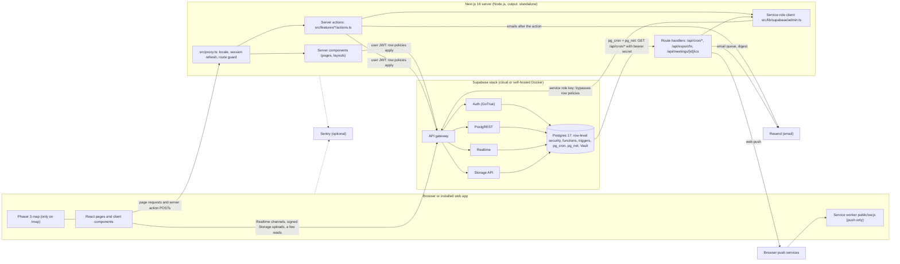
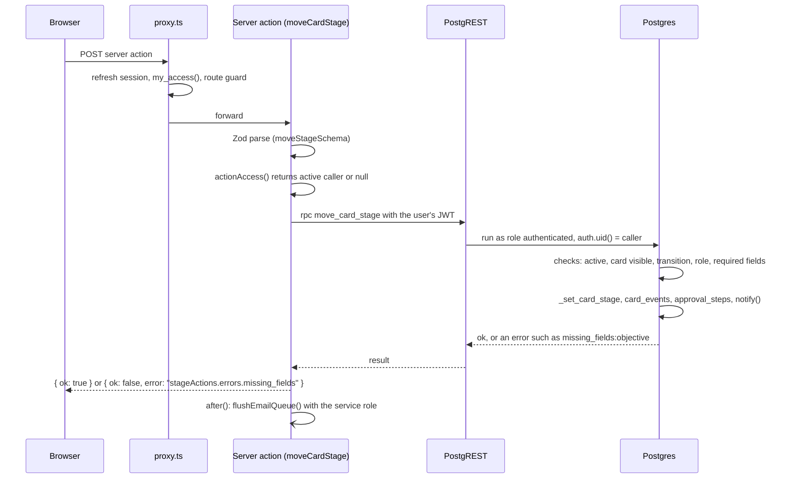
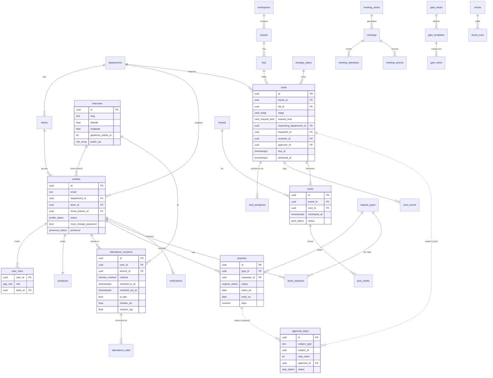
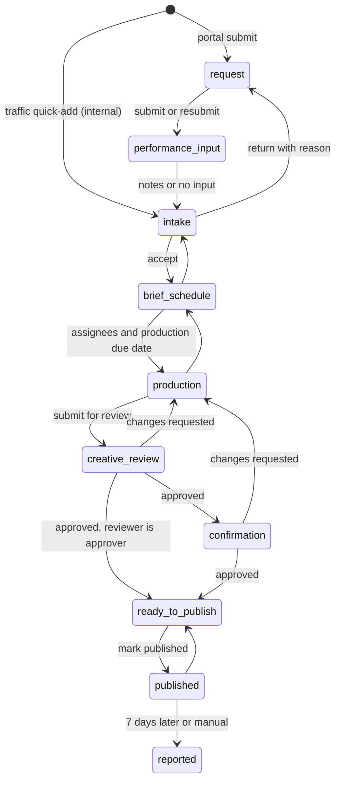

# Marketing HQ: technical guide

This guide explains how Marketing HQ is built and how to run it. It is written for a developer who has never seen the codebase, for example the company's ERP developer who will integrate it with the ERP and may host it on company servers.

How to read it:

- Every path is relative to the repository root. When a statement comes from code, the file is named so you can check it.
- The guide never contains keys, passwords, project references or the addresses of test sites. Where you need a value, it tells you where it comes from.
- Marketing HQ is not tied to one Supabase project or one web host. The app is a Node.js server plus a Supabase stack (Postgres, Auth, PostgREST, Realtime, Storage). Both can run on a cloud service or on company servers. Hosting walk-throughs live in `docs/DEPLOYMENT.md`, `docs/DEPLOY_HOSTING_COM.md` and `docs/DEPLOY_FREE_TEST.md`; this guide gives the portable picture.
- The companion document `docs/ERP_INTEGRATION.md` covers integration with the ERP.
- Product and rule documents that this guide builds on: `CLAUDE.md`, `docs/PRODUCT_SPEC.md`, `docs/DATA_MODEL.md`, `docs/DECISIONS.md`, `docs/SEED_DATA.md`, `docs/BUILD_PLAN.md`, `docs/PROGRESS.md`. If this guide and the code disagree, the code wins; please report it.

## Table of contents

1. [What the product does](#1-what-the-product-does)
2. [Architecture](#2-architecture)
3. [The stack](#3-the-stack)
4. [Repository layout](#4-repository-layout)
5. [Data model](#5-data-model)
6. [Security model](#6-security-model)
7. [Database functions](#7-database-functions)
8. [Server actions and route handlers](#8-server-actions-and-route-handlers)
9. [Business rules that matter for integration](#9-business-rules-that-matter-for-integration)
10. [Scheduled jobs](#10-scheduled-jobs)
11. [Languages, the pixel map and notifications](#11-languages-the-pixel-map-and-notifications)
12. [Configuration](#12-configuration)
13. [Running, testing, deploying and operating](#13-running-testing-deploying-and-operating)
14. [Known limits and open decisions](#14-known-limits-and-open-decisions)

---

## 1. What the product does

### 1.1 Purpose

Marketing HQ is the internal portal of the Espaces marketing department. Espaces is an Egyptian coworking brand with branches in Cairo, Giza, Alexandria and Sharqia. The portal does four jobs:

1. It runs the marketing **content cycle**: every request from another department becomes a card that moves through ten fixed stages, from request to published and reported.
2. It gives other departments a **department portal** to submit requests, follow them, and confirm deliverables.
3. It handles **people operations for the team**: location-based check-in and check-out, leave and special requests with approval chains, a team calendar, a team week, meetings, kudos and celebrations.
4. It shows the team as **pixel-art characters** on a map of the branch while they are checked in.

It does not connect to any outside platform. There is no integration with social networks, ad platforms, Google Calendar or Trello (a one-time Trello import reads an exported file). Publishing is done by hand (`docs/PRODUCT_SPEC.md`, opening section).

### 1.2 Modules

All routes sit under a locale prefix, `/en/...` or `/ar/...` (section 11.1). Pages live in `src/app/[locale]/`.

| Module | Routes | What it does | Main tables |
| --- | --- | --- | --- |
| My Day (home) | `/my-day` | Today's meetings, due cards, approvals, gates, shoots, meeting actions, celebrations and the check-in line | reads many |
| Pixel map | `/map` | The branch floor with checked-in people as characters; tap to walk, wave, high five, invite to coffee or chat | `who_is_in()`, `map_positions`, `map_interactions`, `desks`, `avatars` |
| Check-in | `/checkin` | Check in by location (GPS geofence), office Wi-Fi, field day or work from home; check out with a location | `attendance_sessions`, `attendance_edits` |
| Boards | `/boards`, `/boards/[boardId]`, `/cards/[id]` | Trello-style boards. One special board, the Content Pipeline, has one list per content-cycle stage | `boards`, `lists`, `cards` and card detail tables |
| My work | `/my-work` | My open cards grouped by due date, and cards waiting for my review | `cards`, `card_assignees` |
| Approvals | `/approvals`, `/portal/approvals` | One inbox for every approval step: leaves, special requests, creative review, confirmation | `approval_steps` |
| Department portal | `/portal`, `/portal/requests/new`, `/portal/requests/[id]`, `/portal/files` | Strategic monthly plans and urgent requests from other departments; a five-step tracker; edit and resubmit returned requests; delivered files | `cards`, `strategic_plans`, `attachments` |
| Requests and leave | `/requests`, `/requests/new` | Leaves and special requests from JSON-schema forms, with balances and supporting files | `requests`, `request_types`, `leave_balances` |
| Team calendar | `/calendar` | Month view of absences (leave, work from home, field days), without reasons | `team_absences()` |
| Team week | `/week`, `/portal/week` | Where each person is, day by day | `week_plan_entries`, `team_week()` |
| Content calendar | `/content` | Posts with media and captions by brand, platform and date; month, week, feed preview and list views; publish by hand | `posts`, `post_media` |
| Meetings | `/meetings`, `/meetings/[id]`, `/portal/meetings` | One-off meetings with colleagues and outside guests (email with a calendar file), rooms, notes, action items that become cards; fixed daily, weekly and monthly meetings | `meetings` and related tables |
| Monthly gates | `/gates`, `/gates/rhythm` | The month at a glance: phases, gates, checkpoints and recurring items, built from a standing rhythm | `gate_*` tables |
| Shoots | `/shoots`, `/shoots/new`, `/shoots/[id]`, `/shoots/[id]/call-sheet` | Shoot day planner: crew, shot list, equipment, printable call sheet, linked to field check-in | `shoots` and related tables |
| Celebrations | `/celebrations`, `/portal/celebrations` | Kudos, birthdays and work anniversaries | `kudos`, `profiles` |
| Characters | `/me/character` | Character creator with three saved looks and seasonal outfits | `avatars`, `seasonal_events` |
| Reports | `/reports/workflow`, `/reports/attendance`, `/reports/me`, `/reports/departments` | Dashboards on `security_invoker` views | `v_*` views |
| People | `/people`, `/people/[id]` | Directory and profiles | `profiles` |
| Account | `/me/account`, `/change-password` | Display name, phone, language, password, digest email and phone notifications | `profiles`, `notification_preferences`, `push_subscriptions` |
| Admin | `/admin/launch`, `/admin/users`, `/admin/branches`, `/admin/rooms`, `/admin/organisation`, `/admin/leave`, `/admin/request-types`, `/admin/seasons`, `/admin/settings`, `/admin/import`, `/admin/audit` | Accounts, organisation, branches and geofences, rooms, leave allowances and holidays, request types and chains, seasonal outfits, settings, Trello import, audit log, launch readiness checklist | many |

### 1.3 Users, roles and access tiers

**Roles** are values of the `app_role` enum, stored in `user_roles` (one person can hold several). A `team_lead` row also carries a `team_id` (`supabase/migrations/20261011000001_core.sql`).

| Role | Who holds it | What it unlocks |
| --- | --- | --- |
| `super_admin` | The marketing team lead and the acting managing partner (DECISIONS D-20) | Everything, including admin |
| `leadership` | CEO, managing partner | Reads like marketing (dashboards, boards); write policies exclude it |
| `team_lead` | Team leads, per team (none assigned at the time of writing, D-20) | Their team's people, leave approvals, creative review, post approval |
| `traffic_manager` | The Traffic Manager | Runs the Content Pipeline (intake, briefing, assignment), meetings rhythm, gates, desks, rooms |
| `member` | Marketing staff | Own cards, check-in, requests, character |
| `requester` | Staff of other departments | Department portal |
| `final_approver` | The person who confirms deliverables for a department | Confirmation stage of their department's cards |
| `hr` | HR manager | Leave types and allowances, holidays, schedules, attendance export, lateness grace setting |
| `guest` | Freelancers | Only boards they are members of, My work, and shoots they crew |

**Access tiers** are derived from roles and the department, by SQL helper functions (`supabase/migrations/20261011000001_core.sql`, `20261012000001_boards.sql`, `20261118000001_people_celebrations.sql`). The app shell and the route guard read them in one call, `my_access()`.

| Tier | Definition | Function |
| --- | --- | --- |
| Active user | Own profile has `status = 'active'` | `is_active_user()` |
| Marketing user | Active, holds at least one role, and is in a department with `is_marketing = true` or holds `super_admin` or `leadership` | `is_marketing()` |
| Marketing writer | Marketing user who also holds `super_admin`, `team_lead`, `traffic_manager` or `member` (so leadership alone is read-only) | `is_marketing_writer()` |
| Team app user | Marketing user, or holds `hr`, `leadership`, `super_admin` or `guest` | `is_team_app_user()` |
| Portal user | Holds `requester` or `final_approver` | `is_portal_user()` |
| Staff | Holds any role except `guest` | `is_staff()` |
| Guest only | Every role held is `guest` | `isGuestOnly()` in `src/lib/auth/access.ts` |

An active user with no roles sees a "No access yet" page. An inactive user is signed out.

### 1.4 Where people land

`homePath()` in `src/lib/auth/access.ts` decides the home page: guests go to `/boards`, team app users to `/my-day`, portal-only users to `/portal`, others to `/no-access`. `decideRoute()` in the same file is the coarse route guard used by `src/proxy.ts`:

- Signed out: only `/sign-in` is allowed; everything else redirects to `/sign-in?next=...`.
- Inactive: signed out and sent to `/sign-in?reason=inactive`.
- `must_change_password`: only `/change-password` is allowed.
- `/change-password`, `/me/account` and `/no-access` are open to any signed-in user.
- `/portal/...` needs the portal tier. Portal-only users who open a shared page (`/meetings`, `/celebrations`, `/week`) are sent to the portal copy.
- Guests are limited to `/boards`, `/my-work` and `/shoots`.

Fine-grained checks (admin, reports, every write) happen in pages, server actions and the database (section 6).

---

## 2. Architecture

### 2.1 The picture



### 2.2 What runs where, and why

| Part | Runs where | Responsibilities | Why there |
| --- | --- | --- | --- |
| Browser | User's phone or laptop | React UI, the Phaser map, image and video thumbnails made at upload, resumable uploads, subscribing to Realtime | Thumbnails in the browser avoid server image processing (`next.config.ts` sets `images.unoptimized`) |
| `src/proxy.ts` | Next.js server, every page request (not `/api`, `_next`, files) | next-intl locale redirects, Supabase session refresh (`getClaims`), coarse route guard through `my_access()` | One place for locale and session so pages stay simple. Next.js 16 calls middleware "proxy" |
| Server components | Next.js server | Render pages with the user's own Supabase client, so row policies decide what is read | Every route is per user; `cacheComponents` is off (`CLAUDE.md`) |
| Server actions | Next.js server | Every write from the UI. Each validates input with Zod, checks the caller, then calls the database as the user (or, for a few, with the service role) | Input validation and the user-facing error keys live next to the feature |
| Route handlers | Next.js server, `src/app/api/` | Scheduled job entry points (`/api/cron/*`, bearer secret), HR CSV export, meeting calendar files | Jobs that need Node.js code (email, web push, digest) |
| PostgREST | Supabase stack | Turns HTTP calls from supabase-js into SQL as the `authenticated` role with the user's JWT claims | Standard Supabase data API |
| Postgres | Supabase stack | All business rules that must hold for everyone: row policies, column grants, `security definer` functions for multi-step actions, triggers for activity, audit, notifications and live events | Rules in the database cannot be skipped by a modified browser or a buggy page |
| Auth (GoTrue) | Supabase stack | Email and password accounts, sessions, bans. Public sign-up is disabled | Accounts are created by admins only (D-01) |
| Realtime | Supabase stack | Postgres Changes (row policies apply) for boards, notifications, posts, meetings, gates, kudos; private broadcast channels `branch:<id>` for the map | Live updates in under two seconds |
| Storage | Supabase stack | Three private buckets; files are served through signed URLs that expire after 10 minutes | Files never become public |
| pg_cron and pg_net | Inside Postgres | Run scheduled jobs: SQL jobs directly, and app jobs by calling `/api/cron/*` over HTTPS | The web host does not need a scheduler (section 10) |
| Resend | Outside service | Transactional email, daily digest, meeting guest invitations | Optional: without a key, emails are only logged as previews |
| Push services | Outside (browser vendors) | Deliver web push to installed apps | Standard Web Push with VAPID keys |
| Sentry | Outside, optional | Error reporting when `NEXT_PUBLIC_SENTRY_DSN` is set | Off when the variable is empty |

### 2.3 What "portable" means here

The app does not talk to Postgres directly. It uses `@supabase/supabase-js` and `@supabase/ssr` against the Supabase HTTP API (`/auth/v1`, `/rest/v1`, `/realtime/v1`, `/storage/v1`). So the minimum backend is a **Supabase stack**, either the managed cloud service or Supabase's self-hosted Docker setup. A plain Postgres server is not enough.

What the database needs (all present in Supabase's own Postgres image):

| Feature | Used for | Where it is created |
| --- | --- | --- |
| Postgres 17 | `supabase/config.toml` sets `major_version = 17` | |
| `auth` schema and `auth.uid()` | Every policy and function | Supabase Auth |
| `storage` schema | Bucket policies | Supabase Storage |
| `realtime.messages`, `realtime.send()`, publication `supabase_realtime` | Map events, Postgres Changes | Supabase Realtime |
| `pgcrypto` (`gen_random_uuid`) | Primary keys | built in |
| `btree_gist` | Room double-booking guard on `meetings` | `20261118000002_meetings.sql` |
| `pg_cron` | Scheduled jobs | `20261119000001_scheduled_jobs.sql` |
| `pg_net` | Jobs that call the app over HTTPS | same |
| Vault (`vault.decrypted_secrets`) | App URL and cron secret for `pg_net` calls | `supabase/production-cron.sql` |

The Next.js app is a standard Node.js server (`next.config.ts` sets `output: "standalone"`, which produces `.next/standalone/server.js`). It runs on any host with Node.js 20.9 or newer: a VPS, a container, cPanel's Node.js app feature, Vercel or Netlify.

### 2.4 Life of a request

**Reading a page.** The browser requests `/en/boards/...`. `src/proxy.ts` refreshes the session cookie, calls `my_access()` and applies `decideRoute()`. The page (a server component) creates a Supabase client bound to the user's cookies (`src/lib/supabase/server.ts`) and queries tables. PostgREST runs the SQL as `authenticated` with the user's JWT, so row policies filter every row.

**Writing.** A client component calls a server action. The action parses its input with Zod, reads the caller with `actionAccess()` (`src/lib/auth/session.ts`), and calls either a table (where row policies and column grants are enough) or a `security definer` function through `.rpc(...)` (where the rule has several steps). Errors come back as message keys that the UI translates.



**Live updates.** Triggers in Postgres send broadcast events on private `branch:<id>` channels (`realtime.send`). Browsers subscribe with their JWT; a policy on `realtime.messages` lets only marketing users receive them. Board, notification, post, meeting, gate and kudos pages listen to Postgres Changes, which also respect row policies (`src/hooks/use-realtime-refresh.ts`).

**Scheduled work.** `pg_cron` runs SQL functions (`cron_*`) inside the database, and for email, push and the digest it calls the app's `/api/cron/*` routes through `pg_net` with a bearer secret (section 10).

---

## 3. The stack

Versions are the ones in `package.json` at the time of writing. `^` means compatible minor and patch updates are allowed by the lockfile `pnpm-lock.yaml`.

### 3.1 Runtime and tools

| Piece | Version | Why |
| --- | --- | --- |
| Node.js | 20.9 or newer (`docs/DEPLOY_HOSTING_COM.md`); CI uses 22 (`.github/workflows/ci.yml`); `netlify.toml` pins 22 | Next.js 16 requirement |
| pnpm | 12.11.2 (`packageManager`), through Corepack | Fast installs, strict dependency graph |
| TypeScript | ^5, strict mode (`tsconfig.json`) | Types end to end, generated database types |
| Postgres | 17 (`supabase/config.toml`) | Database |
| Supabase CLI | `supabase` ^2.120.0 (dev dependency, run as `pnpm supabase ...`) | Local stack, migrations, type generation, advisors |

### 3.2 Application dependencies

| Package | Version | Why it is used |
| --- | --- | --- |
| `next` | 16.4.6 | App Router, server components, server actions, route handlers, `proxy.ts` |
| `react`, `react-dom` | 19.3.0 | UI |
| `@supabase/supabase-js` | ^2.117.3 | Supabase client (database, auth, storage, realtime) |
| `@supabase/ssr` | ^0.12.7 | Cookie-based sessions for server and browser clients |
| `next-intl` | ^4.14.9 | English and Arabic, locale routing, message formatting |
| `zod` | ^4.6.7 | Validation at every input boundary |
| `react-hook-form`, `@hookform/resolvers` | ^7.89.0, ^5.9.1 | Forms with field-level errors |
| `@tanstack/react-query` | ^5.104.1 | Client data that needs live updates |
| `phaser` | 3.90.0 | The pixel map engine |
| `@dnd-kit/core`, `@dnd-kit/sortable`, `@dnd-kit/utilities` | ^6.3.1, ^10.0.0, ^3.2.2 | Drag and drop on boards and the content calendar |
| `fractional-indexing` | ^4.0.0 | Order keys for lists, cards, checklist items and media |
| `date-fns`, `@date-fns/tz` | ^4.4.0, ^1.5.0 | Dates in the `Africa/Cairo` time zone (`src/lib/dates.ts`) |
| `recharts` | ^3.10.1 | Dashboards |
| `resend` | ^6.32.1 | Email |
| `web-push` | ^4.0.0 | Phone notifications (VAPID) |
| `tus-js-client` | ^4.3.1 | Resumable uploads over 6 MB to Supabase Storage |
| `@sentry/nextjs` | ^11.6.0 | Error reporting (optional) |
| `radix-ui`, `cmdk`, `react-day-picker`, `sonner`, `lucide-react`, `class-variance-authority`, `clsx`, `tailwind-merge`, `tw-animate-css`, `next-themes` | see `package.json` | shadcn/ui components, toasts, icons, styling helpers |
| `server-only` | ^0.0.1 | Build error if a server module is imported into client code |

### 3.3 Development dependencies

| Package | Version | Why |
| --- | --- | --- |
| `tailwindcss`, `@tailwindcss/turbopack` | ^4 | Styling with theme tokens; logical properties for right to left |
| `shadcn` | ^4.21.4 | Generates components into `src/components/ui/` |
| `vitest` | ^5.0.3 | Unit tests and database access tests |
| `@playwright/test` | ^1.64.0 | End-to-end tests, mobile pass, performance check script |
| `eslint`, `eslint-config-next`, `prettier`, `prettier-plugin-tailwindcss` | see `package.json` | Lint and format |
| `tsx` | ^4.23.15 | Runs TypeScript scripts in `scripts/` |
| `pngjs`, `@types/pngjs` | ^7.0.0 | Placeholder art and icon generation |
| `dotenv` | ^18.0.7 | Test and Playwright configuration |
| `netlify-cli` | 27.20.0 | Free test deployment (`docs/DEPLOY_FREE_TEST.md`) |

---

## 4. Repository layout

```
.github/workflows/ci.yml   CI: local Supabase, reset, types check, typecheck, lint, tests, build, advisors, Playwright
docs/                      product, data model, decisions, seed data, build plan, progress, deployment, this guide
public/
  maps/                    Tiled JSON maps (hq.json, field.json, home.json) and the tileset image
  sprites/                 character layer sprite sheets per layer folder, manifest.json
  icons/, brand/           app icons and logos
  sw.js                    service worker (push notifications only, caches nothing)
scripts/                   create-admin, create-staff, package-hosting, i18n-add, perf-check, make-placeholders, make-icons
src/
  proxy.ts                 locale + session refresh + coarse route guard
  instrumentation.ts       Sentry (server), instrumentation-client.ts (browser)
  app/[locale]/
    (auth)/                sign-in, change-password, no-access
    (app)/                 team app pages (map, boards, my-day, ... admin)
    (portal)/portal/       department portal pages
    layout.tsx, page.tsx   locale layout (dir="rtl" for Arabic), root redirect
  app/api/
    cron/<job>/route.ts    eight scheduled job endpoints (bearer secret)
    export/hr/route.ts     HR CSV export (session + role check)
    meetings/[id]/ics/     calendar file for one meeting
  app/manifest.ts          web app manifest (installable)
  components/              shared components: shell (sidebar, bottom bar, bell), forms, states, file dropzone
  components/ui/           shadcn/ui components (generated)
  features/<module>/       per module: components, server actions (*actions.ts), queries, Zod schemas, pure helpers + tests
  game/                    Phaser engine, scenes, map loader, avatar compositor, life simulation, placeholder art generators
  hooks/                   use-realtime-refresh, use-message
  i18n/                    next-intl routing, request config, navigation helpers
  lib/                     supabase clients, auth guards, dates, geo, ip, crypto, cron, email, push, uploads, nav
  messages/                en.json, ar.json
supabase/
  config.toml              local stack configuration (auth, storage limits, seeds)
  migrations/              24 migrations, applied in name order; never edited once applied
  seed/                    local and staging seed files, loaded in name order
  seed-production.sql      production seed (no users, no demo data)
  production-cron.sql      Supabase Cron schedule + Vault secrets
  staff.json               the staff roster used by scripts/create-staff.mts
  tests/                   Vitest access-rule tests against the local database
tests/
  e2e/                     Playwright tests
  unit/                    extra unit tests (message files)
  stubs/                   test stub for `server-only`
next.config.ts, vercel.json, netlify.toml, playwright.config.ts, vitest.config.mts, eslint.config.mjs
```

### 4.1 `src/features/` by module

| Folder | Contents |
| --- | --- |
| `admin` | Users table and dialogs, account actions (create, update, reset password, activate), branches, desks, organisation, request types, settings |
| `approvals` | The approvals inbox and its query |
| `auth` | Sign-in, sign-out, change password, account form |
| `boards` | Boards, lists, Kanban, table view, workload, card sheet (fields, assignees, labels, checklists, comments, attachments, activity, review panel, stage actions), attachment uploads |
| `calendar` | Team calendar month grid |
| `celebrations` | Kudos feed and dialog, birthdays and anniversaries |
| `character` | Character creator, looks, seasonal panel |
| `checkin` | Check-in panel, geolocation, field form, auto check-out confirmation |
| `content` | Content calendar views, post sheet (editor, preview, media, publishing), ready-to-schedule panel |
| `gates` | Monthly gates timeline, agenda, item sheet, rhythm editor |
| `hr` | Allowances, holidays, HR export form |
| `launch` | Launch readiness checklist, bulk allowances, birthdays, organisation catalog, rooms and seasons editors |
| `map` | Map view, live hook, positions, interactions, signs |
| `meetings` | Meetings list and sheet, fixed meetings (series), rooms, attendees, guests and invitations, calendar files, notes, action items |
| `my-day` | My Day queries and sections (also used by the email digest) |
| `my-work` | Grouping of my cards |
| `notifications` | Mark read, notification text |
| `people` | Directory and profile card |
| `portal` | Request forms, request view, resubmit, delivered files, status mapping |
| `presence` | Status picker action |
| `push` | Device registration, notification settings |
| `reports` | Workflow, attendance, personal and department dashboards |
| `requests` | Request form renderer, list, actions |
| `shoots` | Shoots, crew, shots, equipment, call sheet |
| `tracker` | Five-step request tracker and strategic deadline banner |
| `trello` | Trello JSON import |
| `week` | Team week grid and plan entries |

### 4.2 `src/lib/`

| File | Purpose |
| --- | --- |
| `supabase/server.ts` | Server client acting as the signed-in user (cookies) |
| `supabase/browser.ts` | Browser client (singleton) |
| `supabase/admin.ts` | Service-role client. The only place the service role key is read in the app |
| `supabase/database.types.ts` | Generated types (`pnpm db:types`) |
| `auth/access.ts` | `Access` type, `homePath`, `decideRoute`, role helpers |
| `auth/session.ts` | `getAccess` (cached per request), `requireAccess`, `requireRole`, `actionAccess` |
| `actions.ts` | `ActionResult`, `ok`, `fail`, Zod error mapping, database error mapping, `safeNext` |
| `dates.ts` | Cairo time helpers, working days |
| `geo.ts` | Haversine distance, nearest branch, geofence rule (mirrors SQL) |
| `ip.ts` | IPv4 and IPv6 CIDR matching, client IP from headers |
| `crypto.ts` | Constant-time compare, temporary password generator |
| `cron.ts` | Bearer secret check for cron routes |
| `email/` | Email templates, queue flush, digest |
| `push/` | Push rendering, endpoint allowlist, queue flush |
| `uploads/` | File rules, storage paths, signed and resumable upload transport |
| `nav.ts` | Navigation entries per role |
| `env.ts` | Public configuration read at build time |

---

## 5. Data model

61 tables (62 created, `branch_secrets` later dropped), six views, 24 migrations. All in the `public` schema. Field-level detail lives in the migrations; this section gives the shape and the relationships. `docs/DATA_MODEL.md` is the design document and remains the reference for access rules.

### 5.1 Conventions

- Primary keys are `uuid default gen_random_uuid()`, except `profiles.id` (equals `auth.users.id`), `avatars.user_id`, `notification_preferences.user_id`, `map_positions.user_id`, `settings.key`, `cron_log.key` and composite keys on join tables.
- Every timestamp is `timestamptz`. Business days are computed in `Africa/Cairo` (section 9.1).
- Rows that change have `updated_at`, maintained by the `set_updated_at()` trigger.
- Order keys (`lists.position`, `cards.position`, `checklists.position`, `checklist_items.position`, `post_media.position`) are fractional-index strings with `collate "C"`.
- Cards, boards and lists are soft-deleted with `archived_at`. Shoots also have `archived_at`.
- Every table has row-level security enabled (section 6).

### 5.2 Enums

| Enum | Values |
| --- | --- |
| `app_role` | super_admin, leadership, team_lead, traffic_manager, member, requester, final_approver, hr, guest |
| `profile_status` | active, inactive |
| `presence_status` | available, focus, meeting, shoot, break, away |
| `checkin_method` | gps, wifi, qr, field, home, manual (`qr` is retired and refused; `manual` is never accepted by `check_in`) |
| `card_stage` | request, performance_input, intake, brief_schedule, production, creative_review, confirmation, ready_to_publish, published, reported |
| `card_request_kind` | strategic, urgent, internal |
| `card_priority` | low, normal, high, urgent |
| `assignee_role` | design, copy, video, media_buying, other |
| `revision_reason` | brief_changed, quality, new_information, other |
| `request_status` | pending, approved, rejected, cancelled |
| `step_status` | waiting, active, approved, rejected, changes_requested, skipped |
| `post_status` | draft, in_review, approved, scheduled, published |
| `content_pillar` | awareness, engagement, insights, offer, community |
| `meeting_status` | scheduled, done, cancelled |
| `meeting_cadence` | daily, weekly, monthly |
| `attendee_response` | pending, accepted, declined, tentative |
| `gate_kind` | phase, gate, checkpoint, recurring |
| `gate_status` | not_started, in_progress, done, at_risk, missed, skipped |
| `shoot_status` | planned, confirmed, wrapped, cancelled |
| `week_plan_kind` | branch, field, home, away |

Some lists are text with check constraints instead of enums: `boards.visibility` (marketing, private), `card_events.kind`, `attachments.kind` (file, link), `request_types.category` (leave, special), `approval_steps.subject_type` (request, card), `posts.format` (feed, carousel, reel, story, text), `post_media.media_type` (image, video), `kudos.badge`, `map_interactions.kind`, `meeting_series.audience` (marketing, custom).

### 5.3 People and organisation

| Table | Key columns | Notes |
| --- | --- | --- |
| `departments` | `slug` unique, `name_en`, `name_ar`, `is_marketing`, `default_approver_id` → profiles | `is_marketing` drives the marketing tier. The default approver is copied to new department cards (D-12). Production seed adds a `management` department |
| `teams` | `department_id`, `slug` unique, names, `color` | Seeded teams: traffic, creative, performance, community (all in marketing). Colour is the map name-tag colour |
| `branches` | `slug` unique, names, `area`, `map_key`, `public_ips cidr[]`, `checkin_methods checkin_method[]` (default gps, wifi, field, home; never qr), `latitude`, `longitude` (both or neither), `geofence_radius_m` (25 to 2000, default 150), `location_confirmed_at`, `is_active` | Setting the coordinates while signed in stamps `location_confirmed_at` (trigger `branch_location_confirm`) |
| `profiles` | `id` = `auth.users.id`, `email` (mirrors auth), `full_name`, `display_name`, `phone`, `department_id`, `team_id`, `home_branch_id`, `title`, `locale` (en, ar), `status`, `must_change_password`, `presence`, `presence_updated_at`, `avatar_seen`, `birth_month`, `birth_day` (never a year), `joined_on`, `celebrate` | Created by the `on_auth_user_created` trigger (`handle_new_user`) with a default `schedules` row. Email changes in `auth.users` are copied by `handle_user_email_change` |
| `user_roles` | `user_id`, `role`, `team_id` (required for `team_lead`), unique (user, role, team) | Written only through `admin_set_roles` (or the service role) |
| `schedules` | `user_id` unique, `workdays int[]` (0 = Sunday ... 6 = Saturday; default 6,0,1,2,3,4), `start_time` 10:00, `end_time` 18:00, `timezone` | Used for lateness, auto check-out time, team week "off" days |
| `settings` | `key` primary key, `value jsonb` | Keys: `lateness_grace_minutes` (15), `wip_limit` (6), `monthly_post_target` (12), `strategic_deadline_day` (25), `stage_targets_hours`, `verticals`, `formats`, `platforms`, `post_platforms`, `digest_hour` (8), `meeting_actions_board_id` |
| `audit_log` | `actor_id`, `table_name`, `row_id`, `action` (insert, update, delete), `old_data`, `new_data`, `at` | Written only by the `audit_row()` trigger. Read by super_admin |
| `holidays` | `day` unique, names, `is_half_day` | Full holidays are not working days; half days count 0.5 in leave |

### 5.4 Boards and cards

| Table | Key columns | Notes |
| --- | --- | --- |
| `brands` | `slug`, `name`, `color` | espaces, cocafe, spaces-planner |
| `workspaces` | `slug`, names, `team_id`, `position` | Traffic, Creative, Performance, Community, Projects |
| `boards` | `workspace_id`, `name`, `description`, `is_pipeline` (exactly one true), `visibility`, `created_by`, `archived_at` | The Content Pipeline is the pipeline board. "Meeting actions" board receives meeting action cards (`settings.meeting_actions_board_id`) |
| `board_members` | `board_id`, `user_id` | Private boards and guests |
| `lists` | `board_id`, `name`, `position`, `stage` (pipeline only, unique per board), `archived_at` | Pipeline lists are fixed (trigger `lists_pipeline_guard`) |
| `cards` | `board_id`, `list_id`, `position`, `title`, `description`, `objective`, `key_message`, `reference_links jsonb`, `performance_notes`, `stage`, `request_kind`, `requesting_department_id`, `requester_id`, `vertical`, `brand_id`, `branch_id`, `format`, `platforms text[]`, `priority`, `due_at`, `stage_due_at`, `stage_entered_at`, `due_notified_for`, `reviewer_id`, `approver_id`, `revision_count`, `is_late_submission`, `returned_reason`, `missing_items text[]`, `urgent_reason`, `budget_note`, `strategic_plan_id`, `delivered_at`, `published_at`, `archived_at`, `created_by` | Only pipeline cards have a stage, and their list must match their stage (trigger `cards_pipeline_guard`). Cards cannot move between boards |
| `card_assignees` | `card_id`, `user_id`, `role assignee_role` | |
| `card_events` | `card_id`, `actor_id`, `kind`, `from_stage`, `to_stage`, `data` | Activity feed. Kinds: created, stage_change, assign, unassign, due_change, revision, returned, resubmitted, comment, import, update, approval, archived, attachment, label, checklist. Written by triggers and functions only |
| `card_stage_periods` | `card_id`, `stage`, `entered_at`, `left_at` | Time in each stage (reports) |
| `labels`, `card_labels` | per board | |
| `checklists`, `checklist_items` | `title`, `text`, `done`, `position`, `assignee_id`, `due_at` | |
| `comments` | `card_id`, `author_id`, `body`, `mentions uuid[]`, `edited_at` | Mentions notify (trigger) |
| `attachments` | `card_id`, `uploaded_by`, `kind` (file, link), `storage_path` or `url`, `name`, `mime`, `size` | Files in bucket `card-attachments` |
| `strategic_plans` | `department_id`, `submitted_by`, `for_month` (first of month), `submitted_at`, `is_late` | One submission, many cards |

### 5.5 Portal, requests and approvals

| Table | Key columns | Notes |
| --- | --- | --- |
| `request_types` | `key` unique, names, `category` (leave, special), `form_schema jsonb` (`{fields:[{name,type,required,label_en,label_ar,options,min,max}]}`), `approval_chain jsonb` (`[{resolve:"..."}]`), `is_leave`, `counts_working_days`, `requires_attachment_after_days`, `is_active` | Seeded: annual_leave, sick_leave, casual_leave, unpaid_leave, work_from_home, permission, overtime, equipment, purchase, training, other |
| `requests` | `type_id`, `requester_id`, `status`, `data jsonb` (form values, plus `files` paths), `starts_on`, `ends_on`, `days`, `submitted_at`, `decided_at` | No client writes. Created by `submit_request`, cancelled by `cancel_request` |
| `approval_steps` | `subject_type` (request, card), `subject_id` (no foreign key: polymorphic), `card_stage`, `step_index`, `approver_id`, `status`, `comment`, `revision_reason`, `decided_at` | One row per candidate approver. Rows with the same subject and index are siblings |
| `notifications` | `user_id`, `kind`, `title`, `body`, `link`, `data jsonb`, `read_at`, `emailed_at`, `pushed_at` | Inserted by `notify()`. Owner may only set `read_at` |

### 5.6 Attendance and location check-in

| Table | Key columns | Notes |
| --- | --- | --- |
| `desks` | `branch_id`, `zone_name` (`desk-<n>`, matches the Tiled map), `assigned_user_id` | |
| `attendance_sessions` | `user_id`, `branch_id` (null for field and home), `method`, `checked_in_at`, `checked_out_at`, `is_late`, `auto_closed`, `confirmed_at`, `field_card_id`, `shoot_id`, `note`, `verify jsonb`, `checkin_lat`, `checkin_lng`, `checkin_accuracy_m`, `checkin_place`, `checkout_lat`, `checkout_lng`, `checkout_accuracy_m`, `distance_m` | One open session per user (partial unique index). No client writes. `verify` holds how it was verified, for example `{"geofence":{"radius_m":150,"distance_m":40}}` or `{"ipMatched":"<cidr>"}` |
| `attendance_edits` | `session_id`, `edited_by`, `old_in`, `new_in`, `old_out`, `new_out`, `reason` | Written by `confirm_auto_checkout` and `admin_edit_session` |

### 5.7 Leave and requests

`leave_balances` holds `user_id`, `type_id`, `year`, `allowance` (≥ 0), `used`, unique per user, type and year. HR and super_admin write it; approval and cancellation update `used` inside functions. Holidays are in 5.3. Request files live in bucket `request-files` under `requests/<requester_id>/`.

### 5.8 Content calendar

| Table | Key columns | Notes |
| --- | --- | --- |
| `posts` | `brand_id`, `card_id` (unique when set), `branch_id`, `platforms text[]`, `scheduled_at`, `format`, `caption_ar`, `caption_en`, `hashtags text[]`, `first_comment`, `pillar`, `notes`, `status`, `owner_id`, `publisher_id`, `approved_by`, `review_comment`, `reminded_for`, `overdue_notified_at`, `published_at`, `published_links jsonb` | Trigger `posts_status_guard`: an approved post becomes `scheduled` when it has a time, and back to `approved` when the time is cleared; a new time resets the overdue alert |
| `post_media` | `post_id`, `attachment_id`, `storage_path`, `thumbnail_path`, `media_type`, `width`, `height`, `duration_seconds`, `position` | Files in bucket `post-media` under `posts/<post_id>/` |

### 5.9 Meetings

| Table | Key columns | Notes |
| --- | --- | --- |
| `meeting_rooms` | `branch_id`, names, `capacity`, `is_active` | |
| `meeting_series` | `title`, `title_ar`, `agenda`, `cadence`, `weekdays int[]`, `month_days int[]`, `start_time`, `duration_minutes`, `room_id`, `online_url`, `owner_id`, `audience` (marketing, custom), `starts_on`, `ends_on`, `is_active`, `created_by` | Fixed meetings. Six series seeded (stand-up, spending gate, weekly sync, Gate 5, MQL review, Gate 25) |
| `meeting_series_members` | `series_id`, `user_id` | |
| `meetings` | `series_id`, `occurrence_on` (unique with series), `detached`, `title`, `agenda`, `notes`, `starts_at`, `ends_at` (≤ 12 h), `room_id`, `location_text`, `online_url`, `is_private`, `organizer_id`, `status`, `reminded_at` | Exclusion constraint: a room cannot hold two scheduled meetings at once |
| `meeting_attendees` | `meeting_id`, `user_id`, `response`, `responded_at`, `presence_set` | |
| `meeting_guests` | `meeting_id`, `name`, `email`, `invited_at` | Outside guests, invited by email |
| `meeting_actions` | `meeting_id`, `title`, `assignee_id`, `due_on`, `done`, `card_id`, `created_by` | Can become a card; archiving the card marks the action done |

### 5.10 Monthly gates

| Table | Key columns | Notes |
| --- | --- | --- |
| `gate_tracks` | `key`, names, subtitles, `position`, `is_active` | content-social, publishing, performance, mql-review |
| `gate_templates` | `track_id`, `kind`, names, `start_day`, `end_day` (1 to 31), `weekdays` (recurring only), `owner_id`, `position`, `is_active` | The standing rhythm |
| `gate_items` | `month`, `track_id`, `template_id`, `kind`, names, `starts_on`, `due_on`, `owner_id`, `status`, `note`, `customised`, `position`, `completed_at`, `completed_by` | Dated copies for one month; unique (template, month, due date) |
| `gate_item_cards` | `item_id`, `card_id` | Cards linked to a gate |
| `gate_item_exclusions` | `template_id`, `month`, `due_on` | Occurrences deleted or moved by a manager, so the builder does not recreate them |

### 5.11 Shoots and team week

| Table | Key columns |
| --- | --- |
| `shoots` | `title`, `shoot_on`, `call_time`, `wrap_time`, `branch_id` or `location_name`, `location_url`, `status`, `producer_id`, `brief`, `backup_plan`, `created_by`, `archived_at` |
| `shoot_crew` | `shoot_id`, `user_id` or `external_name`, `role`, `call_time`, `confirmed` |
| `shoot_shots` | `shoot_id`, `position`, `description`, `shot_type`, `card_id`, `done`, `notes` |
| `shoot_equipment` | `shoot_id`, `item`, `quantity`, `owner_id`, `packed`, `returned` |
| `shoot_cards` | `shoot_id`, `card_id` |
| `week_plan_entries` | `user_id`, `day` (unique with user), `kind`, `branch_id` (required for branch), `place`, `created_by` |

### 5.12 Kudos, celebrations, seasonal outfits, characters

| Table | Key columns | Notes |
| --- | --- | --- |
| `kudos` | `from_id`, `to_id` (not self), `badge` (teamwork, creative, on_time, helped, great_idea, birthday), `message` (1 to 280) | |
| `seasonal_events` | `key`, names, `starts_on`, `ends_on`, `items text[]` (outfit option ids), `is_active` | Six seeded events with expected dates |
| `avatars` | `user_id`, `config jsonb`, `looks jsonb` (at most three) | Character configuration |
| profile fields | `birth_month`, `birth_day`, `joined_on`, `celebrate` | Birthdays never store a year |

### 5.13 Push, digest and job bookkeeping

| Table | Key columns | Notes |
| --- | --- | --- |
| `push_subscriptions` | `user_id`, `endpoint` (https, unique), `p256dh`, `auth`, `user_agent`, `last_used_at` | Owner only |
| `notification_preferences` | `user_id`, `digest_email`, `push_enabled` | Owner only |
| `cron_log` | `key` primary key, `at` | Once-only keys for reminders (`_once`, `claim_once`). No client access; pruned after 120 days |

### 5.14 Map

| Table | Key columns | Notes |
| --- | --- | --- |
| `map_positions` | `user_id` primary key, `branch_id`, `tile_x`, `tile_y` (0 to 500) | Written by `map_move`, cleared at check-out |
| `map_interactions` | `from_id`, `to_id`, `kind` (wave, high_five, coffee, chat, dance, clap) | Written by `map_interact`, pruned after 30 days |

### 5.15 Dashboard views

All six are `security_invoker = true`, so the reader's row policies apply (`20261016000001_content.sql`).

| View | Grain | Columns |
| --- | --- | --- |
| `v_card_flow` | pipeline card | created, delivered, due, `on_time`, `days_to_deliver`, revisions, department, vertical, brand, kind, late flag, stage |
| `v_stage_durations` | card and stage period | hours in stage |
| `v_workload` | assignee and stage | open cards in brief_schedule, production, creative_review, confirmation |
| `v_attendance_daily` | user and Cairo day | checked in, first arrival, late, first method, hours (open sessions count up to 12 h) |
| `v_leave_usage` | user, type, year | allowance, used, remaining |
| `v_posts_monthly` | brand and Cairo month | published, scheduled, target |

### 5.16 Storage buckets

| Bucket | Size limit | Paths |
| --- | --- | --- |
| `card-attachments` | 100 MB | `cards/<card_id>/<file>`; drafts `drafts/<uploader_id>/<file>` (portal media picked before the card exists) |
| `request-files` | 20 MB | `requests/<requester_id>/<file>` |
| `post-media` | 500 MB | `posts/<post_id>/<file>` (original and browser-made thumbnail) |

### 5.17 Main entities



---

## 6. Security model

### 6.1 Principles

1. **The database enforces the rules.** Server actions validate input and give good error messages, but every read and write is also checked in Postgres, so a modified browser or a direct PostgREST call cannot do more than the UI allows. Hiding a button is never the check (`CLAUDE.md`, Security rule 5).
2. **Least privilege by default.** The first migration revokes default grants from `anon`, and every migration ends with `revoke execute on all functions in schema public from public, anon;`. Tables get row-level security and narrow grants (`20261011000001_core.sql`).
3. **The service role is confined** to server code in a handful of places (6.7).

### 6.2 The four mechanisms

From `docs/DATA_MODEL.md` section 0, as implemented:

| Mechanism | What it decides | Example |
| --- | --- | --- |
| Row policies | Which rows a user can read, insert, update, delete | `cards_select` uses `card_visible(board_id, requesting_department_id, approver_id)` |
| Column grants | Which columns a user can change | `revoke update on cards from authenticated; grant update (title, description, ...) on cards to authenticated;` so `stage`, `revision_count`, `reviewer_id` cannot be set directly |
| `security definer` functions | Multi-step actions and narrow reads. They run as the table owner, set `search_path = public`, check the caller themselves, and have explicit `execute` grants | `move_card_stage`, `decide_step`, `check_in`, `who_is_in()` |
| `security_invoker` views | Dashboards that still respect the reader's row policies | `v_card_flow`, `v_attendance_daily` |

Plain (definer) views are never created.

### 6.3 Database roles and app roles

| Database role | Who uses it | Notes |
| --- | --- | --- |
| `anon` | Requests without a session | Has no table grants and no function execute rights. Only the sign-in page works without a session |
| `authenticated` | Every signed-in user, through PostgREST, Realtime and Storage with their JWT | Row policies and column grants apply. `auth.uid()` is the user |
| `service_role` | The Next.js server via `src/lib/supabase/admin.ts`, the account scripts | Bypasses row policies. `auth.uid()` is null, so functions that check app roles refuse it |
| `postgres` | Migrations, `pg_cron` jobs | Owner of tables and functions |

App roles (`app_role`) are rows in `user_roles`; the helper functions below turn them into checks.

### 6.4 Helper functions used in policies

All are `security definer`, `stable`, `search_path = public`, executable by `authenticated`.

| Function | True when |
| --- | --- |
| `is_active_user()` | caller's profile is active |
| `has_role(r)`, `has_any_role(rs)` | caller is active and holds the role(s) |
| `is_marketing()` | marketing tier (1.3) |
| `is_marketing_writer()` | marketing and holds super_admin, team_lead, traffic_manager or member |
| `is_team_app_user()`, `is_portal_user()`, `is_staff()` | tiers (1.3) |
| `in_team(slug)` | caller's team slug equals `slug` |
| `is_team_lead_of(target)` | target is not the caller and the caller is team lead of the target's team |
| `my_department_id()` | caller's department (active only) |
| `is_board_member(board)`, `can_view_board(board)`, `can_edit_board(board)`, `can_add_to_board(board)` | board access (DATA_MODEL section 9) |
| `card_visible(board, department, approver)`, `can_view_card(card)`, `can_edit_card(card)` | card access. Pipeline cards are also visible to the requesting department and to the card's approver |
| `can_view_request(request)` | requester, their team lead, hr, super_admin, or a holder of a step on it |
| `can_view_post(post)`, `post_visible(card)`, `can_approve_posts()` | posts: marketing, plus the requesting department for posts linked to its cards; approvers are team leads and super_admin |
| `in_meeting`, `can_view_meeting`, `can_edit_meeting` | meetings |
| `can_manage_gates()`, `can_update_gate(item)` | super_admin and traffic manager manage; the item owner updates status |
| `on_shoot_crew`, `can_view_shoot`, `can_edit_shoot` | shoots |
| `can_read_request_file(name)` | request file paths |

### 6.5 Column grants (tables where clients may update only some columns)

| Table | Columns a signed-in user may update (still subject to row policies) |
| --- | --- |
| `profiles` | `display_name`, `phone`, `locale`, `presence`, `presence_updated_at`, `avatar_seen`, `birth_month`, `birth_day`, `celebrate` (own row only) |
| `cards` | `title`, `description`, `objective`, `key_message`, `reference_links`, `performance_notes`, `vertical`, `brand_id`, `branch_id`, `format`, `platforms`, `priority`, `due_at`, `stage_due_at`, `budget_note`, `position`, `list_id`, `archived_at` |
| `boards` | `name`, `description`, `visibility`, `archived_at`, `workspace_id` |
| `lists` | `name`, `position`, `archived_at` |
| `comments` | `body`, `mentions`, `edited_at` |
| `notifications` | `read_at` |
| `posts` | `brand_id`, `branch_id`, `platforms`, `scheduled_at`, `format`, `caption_ar`, `caption_en`, `hashtags`, `first_comment`, `pillar`, `notes`, `publisher_id` |
| `meeting_actions` | `title`, `assignee_id`, `due_on`, `done` |

Tables with **no client writes at all** (functions and triggers only): `audit_log`, `user_roles`, `card_events`, `card_stage_periods`, `strategic_plans`, `requests`, `approval_steps`, `attendance_sessions`, `attendance_edits`, `meeting_series`, `meeting_series_members`, `meetings`, `meeting_attendees`, `meeting_guests`, `gate_templates`, `gate_items`, `gate_item_exclusions`, `map_positions`, `map_interactions`, `cron_log`. `profiles` cannot be inserted or deleted by clients; `notifications` cannot be inserted or deleted; `kudos` and `push_subscriptions` cannot be updated.

### 6.6 Row policies in short

| Table | Read | Write |
| --- | --- | --- |
| departments, teams, branches, brands, request_types, holidays, settings, meeting_rooms, seasonal_events | any active user | super_admin; hr also for leave request types, holidays and the `lateness_grace_minutes` setting; traffic manager also for rooms |
| profiles | own row always; marketing, hr, super_admin, leadership read all | own row, granted columns; everything else through `admin_update_profile` |
| user_roles | own; marketing; hr | functions only |
| schedules | own, team lead, hr, super_admin | hr, super_admin |
| desks | marketing | super_admin, traffic manager |
| attendance_sessions, attendance_edits | own; team lead of the user; hr; super_admin; leadership | functions only |
| avatars | any active user | own |
| workspaces, boards, lists, board_members, labels | marketing (private boards: members and super_admin; guests: their boards) | `can_edit_board`, `can_add_to_board`; pipeline lists super_admin only |
| cards and card detail tables | `can_view_card` | insert on free-form boards via `can_add_to_board`; update via `can_edit_card`; pipeline cards only through functions |
| comments, attachments | `can_view_card` | insert if you can view the card (requesters can comment and attach); update or delete your own (attachments also by card editors) |
| strategic_plans | own department, traffic, super_admin, leadership | functions only |
| requests, approval_steps | `can_view_request` / own step / `can_view_card` | functions only |
| leave_balances | own, team lead, hr, super_admin | hr, super_admin |
| posts, post_media | marketing; requesting department for posts linked to its cards | marketing writers; status only through functions |
| notifications | own | own, `read_at` only |
| audit_log | super_admin | triggers only |
| kudos | staff | insert as yourself (not to yourself); delete own or super_admin |
| meetings and children | `can_view_meeting` (marketing sees non-private; others only meetings they are in) | functions only, except action items (people in the meeting) |
| gate_tracks, gate_templates, gate_items | staff | managers (tracks directly, templates and items through functions) |
| shoots and children | marketing or crew | `can_edit_shoot`; delete super_admin and traffic |
| week_plan_entries | own; super_admin, traffic | own from today onward; super_admin and traffic any day |
| push_subscriptions, notification_preferences | own | own |
| map_positions | marketing | functions only |
| map_interactions | sender or recipient | functions only |
| cron_log | nobody | functions only |

`docs/DATA_MODEL.md` section 10 is the full matrix; `supabase/tests/` has one access-test suite per area.

### 6.7 How a request is authorised, end to end

1. **Session.** The browser holds Supabase session cookies set by `@supabase/ssr`. `src/proxy.ts` refreshes them on each page request with `supabase.auth.getClaims()`.
2. **Coarse guard.** `proxy.ts` calls `my_access()` and applies `decideRoute()` (1.4). This only routes; it is not the security boundary.
3. **Page guard.** Pages and layouts call `requireAccess()` or `requireRole(...)` (`src/lib/auth/session.ts`). Example: `src/app/[locale]/(app)/admin/layout.tsx` requires super_admin or hr.
4. **Action guard.** Each server action parses input with a Zod schema, then calls `actionAccess()` (null for signed-out or inactive callers) and checks roles where needed. Example: `createAccount` requires super_admin.
5. **Database guard.** The action calls the database as the user. Row policies, column grants and the function's own checks decide. Example: `admin_update_profile` raises `42501 not allowed` unless the caller holds super_admin (or hr for schedule and people fields).
6. **Audit.** Triggers write `audit_log` rows for sensitive changes (6.12).

### 6.8 Where the service role is used

The key is read only in `src/lib/supabase/admin.ts` (`createAdminClient`, marked `server-only`) and in the two account scripts. Every call site checks the caller first.

| Call site | Why it needs the service role |
| --- | --- |
| `src/features/admin/users-actions.ts` | Create auth users, set temporary passwords, ban and unban, revoke sessions (`admin_revoke_sessions`). Profile and role changes still go through the audited functions as the admin user |
| `src/features/auth/actions.ts` (`changePassword`) | Clear `must_change_password`, which users cannot write |
| `src/features/checkin/actions.ts` | `check_in` is executable by the service role only; the action verifies the geofence or the Wi-Fi IP first, and the function repeats the checks |
| `src/app/api/cron/*/route.ts` | Run `cron_*` functions |
| `src/lib/email/queue.ts`, `src/lib/email/digest.ts`, `src/lib/push/send.ts` | Read the notification queues and recipients across users |
| `src/features/meetings/guest-invites.ts` | Reset `meeting_guests.invited_at`, which clients cannot write |
| `scripts/create-admin.mts`, `scripts/create-staff.mts` | Bootstrap accounts on a fresh project |

Functions executable by `service_role` but **not** by signed-in users: `check_in`, `admin_revoke_sessions`, `notify`, `claim_once`, `workflow_assign_default_owners` and every `cron_*` function. Internal helpers (prefixed `_`) and trigger functions are revoked from `authenticated`, `anon` and `public`. The migrations never revoke Supabase's default execute grant to `service_role`, so the service role can call every function in `public`, internal helpers included (checked against a local database). That is one more reason the key must stay on the server.

### 6.9 Storage rules

All buckets are private. The app hands out signed URLs that expire after 600 seconds (`src/features/boards/attachment-actions.ts`, `src/features/content/media-urls.ts`, `src/features/requests/actions.ts`). Uploads use signed upload URLs created by a server action after its checks, or TUS resumable uploads from the browser for files over 6 MB (`src/lib/uploads/transport.ts`).

| Bucket | Read | Upload | Update (move) | Delete |
| --- | --- | --- | --- | --- |
| `card-attachments` | `cards/<id>/`: `can_view_card`; `drafts/<uid>/`: only that user | same | only your own draft, only into `cards/<id>/` of a card you can view | uploader or `can_edit_card` |
| `request-files` | own folder, or a file listed in `data.files` of a request you can view | own folder, active users | none | owner |
| `post-media` | `can_view_post` of `posts/<id>/` | marketing writers, `posts/` prefix | marketing writers | marketing writers |

`submit_request` also refuses files outside `requests/<caller>/`, so a request cannot point at someone else's file.

### 6.10 Realtime rules

- **Map channels** are private (`supabase.channel('branch:<id>', { config: { private: true } })`). Policies on `realtime.messages` allow `select` (receive) only when the topic starts with `branch:` and `is_marketing()`, and `insert` only for the `presence` extension (`20261014000001_attendance.sql`). Topics: `branch:<uuid>`, `branch:field`, `branch:home`.
- **Events are sent by the database**, never by browsers: `checkin`, `checkout` (trigger on `attendance_sessions`), `status` (trigger on `profiles.presence`), `avatar` (trigger on `avatars`), `move` (`map_move`), `interact` (`map_interact`), `celebrate` (kudos trigger). Payloads carry user ids and tile positions only, never coordinates.
- **Postgres Changes** are published for `cards`, `lists`, `card_assignees`, `comments`, `notifications`, `posts`, `kudos`, `meetings`, `meeting_attendees`, `meeting_actions`, `gate_items`. Row policies decide which changes a subscriber receives.

### 6.11 The cron secret

- `/api/cron/*` routes accept a request only with `Authorization: Bearer <CRON_SECRET>`, compared in constant time (`src/lib/cron.ts`, `src/lib/crypto.ts`). Without `CRON_SECRET` set, every call is refused.
- When jobs run in Supabase Cron, the app URL and the same secret are stored in Vault as `marketing_hq_url` and `marketing_hq_cron_secret` (`supabase/production-cron.sql`). `_cron_call_app(path)` reads them and only calls paths matching `^/api/cron/[a-z-]+$`.
- `src/proxy.ts` skips `/api`, so these routes do their own checks: cron routes the secret, `/api/export/hr` and `/api/meetings/[id]/ics` the user's session.

### 6.12 Audit log

The generic `audit_row()` trigger records `auth.uid()`, table, row id, action and the old and new row as JSON. It runs on:

| Table | Events |
| --- | --- |
| `user_roles` | insert, update, delete |
| `profiles` | update of `status`, `department_id` or `team_id` |
| `cards` | update of `archived_at`, delete |
| `approval_steps` | update (every decision) |
| `requests` | update of `status` |
| `leave_balances` | insert, update, delete |
| `attendance_sessions` | update, delete |
| `attendance_edits` | insert |
| `kudos` | delete |

Passwords never reach the database or the log (they go to Supabase Auth). Super admins read the log at `/admin/audit`. Changes made with the service role are recorded with a null `actor_id`.

### 6.13 Other hardening

- Temporary passwords are 14 characters from an alphabet without look-alikes, generated on the server, shown once to the admin, and never stored or emailed (`src/lib/crypto.ts`, `users-actions.ts`).
- The first sign-in forces a password change; minimum length 10 (`src/features/auth/schemas.ts`, Supabase Auth setting).
- Sign-in errors never reveal whether an account exists (`signIn` in `src/features/auth/actions.ts`).
- Deactivation sets `status = 'inactive'`, bans the auth user for 100 years and deletes its sessions.
- `next.config.ts` turns off server-function argument logging (passwords would otherwise appear in development logs) and image optimisation.
- The HR CSV export prefixes cells that start with `=`, `+`, `-`, `@`, tab or carriage return, so spreadsheets never run them as formulas.
- Push endpoints are limited to the browser vendors' push services (`src/lib/push/endpoint.ts`), so the server can never be aimed at another address.
- Wi-Fi check-in trusts only an address the hosting platform sets (`clientIp` in `src/lib/ip.ts`): the header named by `CLIENT_IP_HEADER` (for example `x-nf-client-connection-ip` on Netlify, `cf-connecting-ip` behind Cloudflare), the first `x-forwarded-for` entry on Vercel, and otherwise the last `x-forwarded-for` entry, which the nearest proxy appends. Set `CLIENT_IP_HEADER` for every host that is not Vercel or a single appending proxy.

### 6.14 What an integrator must never bypass

1. Do not write `cards.stage`, `approval_steps`, `requests`, `attendance_sessions`, `leave_balances.used`, `user_roles`, `posts.status` or `meetings` directly. Use the functions in section 7, or add a new `security definer` function that applies the same rules.
2. Do not put the service role key in a browser, a mobile app, the ERP's front end, or any system you do not control. Prefer a dedicated database role with narrow grants (see `docs/ERP_INTEGRATION.md`).
3. Do not create plain views over these tables; they bypass row policies.
4. Do not expose coordinates (`checkin_lat`, `checkin_lng`, `checkout_*`, `distance_m`) beyond the people who may already see them: the person, their team lead, hr, super_admin, leadership.
5. Do not send events to map channels from outside the database.
6. Keep `search_path = public`, the caller check and explicit `execute` grants on every new function, and end every migration with `revoke execute on all functions in schema public from public, anon;`.
7. Use Cairo time for every business date (section 9.1).

---

## 7. Database functions

Columns: **Caller** is who may call it: `auth` (any signed-in user), `service` (the service role, not signed-in users), `internal` (not executable by signed-in users; called by other functions, triggers or `pg_cron`). The service role keeps Supabase's default execute right on every function (6.8). Every function sets `search_path = public`. All `auth` functions can be called directly through PostgREST (`/rest/v1/rpc/<name>`) by any signed-in user, which is why each one checks the caller itself.

### 7.1 Identity, access and directory

| Function | Caller | Purpose and checks |
| --- | --- | --- |
| `my_access()` | auth | The caller's id, email, names, status, `must_change_password`, locale, presence, department, team, home branch, roles and tier flags, as JSON. Used by the proxy, guards and shell |
| `public_profiles()` | auth | Active people's id, display name, title, team and department. For portal users and guests, who cannot read `profiles` |
| `is_active_user`, `has_role`, `has_any_role`, `is_marketing`, `is_marketing_writer`, `is_team_app_user`, `is_portal_user`, `is_staff`, `in_team`, `is_team_lead_of`, `my_department_id` | auth | Policy helpers (6.4) |
| `try_uuid(text)` | auth | Safe text to uuid (null on failure); used in storage policies |

### 7.2 Administration

| Function | Caller | Purpose and checks |
| --- | --- | --- |
| `admin_update_profile(p_user_id, patch jsonb)` | auth | Updates a profile and schedule from a patch. Allowed keys: `full_name`, `display_name`, `phone`, `department_id`, `team_id`, `home_branch_id`, `title`, `locale`, `status`, `must_change_password` (super_admin only); `workdays`, `start_time`, `end_time`, `birth_month`, `birth_day`, `joined_on` (super_admin or hr). Unknown keys are refused. You cannot deactivate yourself |
| `admin_set_roles(p_user_id, roles jsonb)` | auth | Replaces all roles with the given array `[{role, team_id}]`. super_admin only. You cannot remove your own super_admin |
| `require_password_change(p_user_id)` | auth | Sets `must_change_password`. super_admin only |
| `admin_revoke_sessions(p_user_id)` | service | Deletes the user's `auth.sessions` (password reset, deactivation) |
| `workflow_assign_default_owners()` | service | Sets default owners of gate templates and fixed meetings once the staff accounts exist; never replaces a chosen owner. Uses hard-coded staff email addresses |

### 7.3 Boards and the content cycle

| Function | Caller | Purpose and checks |
| --- | --- | --- |
| `move_card_stage(p_card_id, p_to, p_payload)` | auth | All manual stage moves. Checks: active, card visible, not archived, transition allowed, role allowed for the transition, caller is a marketing writer, required fields. Refuses moves out of review stages. Payload: `stage_due_at`, `assignees`, `performance_notes`, `no_input`, `returned_reason`, `missing_items` (section 9.3) |
| `decide_step(p_step_id, p_decision, p_comment, p_reason)` | auth | Decides an active approval step that belongs to the caller. Requests: approved or rejected (comment required). Cards: approved or changes_requested (reason and comment required). Moves the card or completes the request |
| `set_card_reviewers(p_card_id, p_reviewer, p_approver)` | auth | Traffic manager or super_admin who can view the card |
| `create_internal_card(p_title, p_position)` | auth | Traffic manager or super_admin. Quick-add on the pipeline: an `internal` card in `intake`, reviewer = an active creative team lead if there is one |
| `card_link(p_card_id)` | auth | The in-app link to a card |
| `pipeline_board_id()` | auth | Id of the Content Pipeline board |

### 7.4 Department portal

| Function | Caller | Purpose and checks |
| --- | --- | --- |
| `submit_strategic_plan(payload)` | auth | Requester or final approver with a department. `for_month` must be next month (Cairo). Each line needs a title. Creates the plan and one card per line in `request`, then moves each to `performance_input`. Sets `is_late`. Notifies the performance team lead and traffic |
| `submit_urgent_request(payload)` | auth | Same caller rule. All fields required (title, objective, vertical, brand, format, platforms, due date, `urgent_reason`). One card, priority urgent by default. Notifies traffic and the performance team lead |
| `resubmit_request(p_card_id, payload)` | auth | Anyone in the requesting department, card in `request` with `returned_reason` set. Updates allowed fields, clears missing items and the reason, moves to `performance_input`, notifies traffic |
| `strategic_is_late(for_month, at)` | auth | Whether a submission is after the deadline (section 9.8) |
| `cairo_today()`, `cairo_today(timestamptz)` | auth | Cairo calendar date |
| `working_days(from, to)` | auth | Working days between two dates (section 9.2) |

### 7.5 Requests, leave and approvals

| Function | Caller | Purpose and checks |
| --- | --- | --- |
| `submit_request(type_key, data)` | auth | Active caller. Required form fields, valid dates, working days > 0 where counted, files only under `requests/<caller>/`, file required when days exceed `requires_attachment_after_days`, leave within one year and within balance (allowance − used − pending). Builds approval steps; approves at once if nothing needs approval |
| `cancel_request(p_request_id)` | auth | The requester while pending; hr once approved (refunds `used`). Remaining steps become skipped |
| `team_absences(from, to)` | auth | Approved leave (`leave`), work from home (`wfh`) and field check-in days (`field`) with dates only. Marketing users see marketing; others see their own department |
| `can_read_request_file(name)` | auth | Storage policy helper |

### 7.6 Attendance and presence

| Function | Caller | Purpose and checks |
| --- | --- | --- |
| `check_in(p_user_id, p_method, p_branch_id, p_verify, p_card_id, p_note, p_now, p_lat, p_lng, p_accuracy_m, p_place, p_shoot_id)` | service | Records a check-in after the server action verified it. Repeats every rule: active user, one open session, location required, method rules, geofence for gps, approved WFH for home, lateness (section 9.7) |
| `check_out(p_lat, p_lng, p_accuracy_m)` | auth | Closes the caller's open session; location required |
| `confirm_auto_checkout(p_session_id, p_actual_out)` | auth | Owner of an auto-closed session, once; time between check-in and now. Writes `attendance_edits` |
| `admin_edit_session(p_session_id, p_new_in, p_new_out, p_reason)` | auth | super_admin or hr; reason required. Writes `attendance_edits` |
| `who_is_in(p_branch_id)` | auth | Open sessions (user, branch, method, check-in time, field card, note, field place) for marketing users. Never coordinates or lateness |
| `my_open_session()`, `my_wfh_today()` | auth | The caller's own state |
| `branch_geofence_m(branch)` | auth | Effective radius: at least 1,500 m until the branch point is confirmed |

### 7.7 Content calendar

| Function | Caller | Purpose and checks |
| --- | --- | --- |
| `submit_post(p_post_id)` | auth | Marketing writer; draft → in_review; notifies community team leads |
| `decide_post(p_post_id, p_approve, p_comment)` | auth | team_lead or super_admin; in_review → approved (or scheduled) or back to draft with a required comment; notifies the owner |
| `create_post_from_card(p_card_id, p_scheduled_at)` | auth | Marketing writer; card in `ready_to_publish` without a post. Creates an approved post from the card (brand, platforms, key message, notes, up to 10 media attachments) |
| `mark_post_published(p_post_id, p_links)` | auth | Publisher, community team, team lead or super_admin, and a marketing writer; approved or scheduled → published; moves the linked card to `published` |
| `can_view_post`, `post_visible`, `can_approve_posts` | auth | Policy helpers |

### 7.8 Meetings

| Function | Caller | Purpose and checks |
| --- | --- | --- |
| `save_meeting(p_id, p)` | auth | Staff create; organiser, traffic or super_admin edit. Attendees, guests, room. A move resets responses and reminders and notifies |
| `respond_meeting(p_id, p_response)` | auth | Attendee only; declining notifies the organiser |
| `cancel_meeting(p_id)` | auth | Organiser, traffic or super_admin |
| `save_meeting_notes(p_id, p_notes)` | auth | Anyone in the meeting, or editors |
| `meeting_busy(from, to, user_ids)` | auth | Busy times for people and rooms; shows when, never what |
| `meeting_action_to_card(p_action_id, p_board_id)` | auth | Someone in the meeting who is a marketing writer and can add to the target board (default: the Meeting actions board) |
| `save_meeting_series(p_id, p)`, `archive_meeting_series(p_id)` | auth | super_admin or traffic manager; rebuilds untouched future occurrences |

### 7.9 Monthly gates, shoots, team week

| Function | Caller | Purpose and checks |
| --- | --- | --- |
| `ensure_gate_month(p_month)` | auth | Staff; builds a month from templates within ±12 months |
| `save_gate_template`, `delete_gate_template` | auth | Managers (super_admin, traffic); resync future months, keeping touched items |
| `save_gate_item`, `delete_gate_item` | auth | Managers; moving or deleting a templated item records an exclusion |
| `set_gate_status(p_id, p_status, p_note)` | auth | Managers or the item owner |
| `team_week(from, to, department)` | auth | Staff; one row per person and day (at most 42 days per call) with a place and a source; no coordinates, leave types or reasons |
| `on_shoot_crew`, `can_view_shoot`, `can_edit_shoot` | auth | Policy helpers |

### 7.10 Celebrations and map

| Function | Caller | Purpose and checks |
| --- | --- | --- |
| `upcoming_celebrations(from, days)` | auth | Staff; birthdays and anniversaries in a window of up to 62 days |
| `map_move(p_branch_id, p_x, p_y)` | auth | Marketing user checked in at that branch; at most one move every 400 ms; broadcasts `move` |
| `map_interact(p_to, p_kind)` | auth | Marketing user checked in; target on the same floor; at most 5 per 10 s; broadcasts `interact`; coffee and chat notify the target |

### 7.11 Scheduled job functions (service role)

| Function | What it does |
| --- | --- |
| `cron_due_soon()` | Notifies assignees of cards due within 24 hours, once per due date |
| `cron_daily()` | Moves cards published 7 or more days ago to `reported` |
| `cron_auto_checkout(p_now)` | Closes forgotten sessions (section 9.7) |
| `cron_post_reminders(p_now)` | 30-minute reminder and 2-hour "not marked as published" alert |
| `cron_meetings(p_now)` | Generates fixed meeting occurrences for 35 days, 15-minute reminders, sets and clears "In a meeting", marks ended meetings done |
| `cron_gates(p_now)` | Builds this and next month; reminds owners 3, 1 and 0 days before; overdue alerts 1 to 3 days after |
| `cron_shoots(p_now)` | Reminds the crew the day before |
| `cron_strategic_reminders(p_now)` | Reminds requesters 5 and 1 days before the strategic deadline if their department has not submitted |
| `cron_celebrations(p_now)` | Birthday and anniversary notifications; prunes old map interactions and job keys |
| `cron_workflow_daily(p_now)` | Runs gates, shoots, strategic reminders and celebrations; returns counts |
| `claim_once(p_key)` | Once-only key for server code (digest) |
| `notify(user, kind, link, data, title, body)` | Inserts a notification for an active user |

### 7.12 Internal helpers and triggers (no client access)

| Function | Role |
| --- | --- |
| `_set_card_stage` | Moves a card: closes the stage period, sets list, `stage_entered_at`, `stage_due_at`, `delivered_at` (entering ready_to_publish), `published_at` (entering published), writes the event |
| `_create_card_step` | Creates the active review or confirmation step; raises `missing_reviewer` or `missing_approver` |
| `_creative_lead`, `_notify_role`, `_insert_department_card`, `_require_requester`, `_check_line` | Portal helpers |
| `_resolve_approvers`, `_build_request_steps`, `_finish_request` | Approval engine (section 9.5) |
| `_has_wfh_today`, `_branch_topic`, `_distance_m` | Attendance helpers (haversine in metres) |
| `_is_workday`, `_roll_back_workday`, `_once` | Calendar and once-only helpers |
| `_series_dates`, `_generate_meetings` | Fixed meetings |
| `_build_gate_month`, `_sync_gate_months` | Gates |
| `_cron_call_app(path)` | Calls the app's `/api/cron/<job>` with the Vault secret through `pg_net` |
| Triggers: `set_updated_at`, `handle_new_user`, `handle_user_email_change`, `audit_row`, `cards_pipeline_guard`, `lists_pipeline_guard`, `card_activity`, `assignee_activity`, `comment_activity`, `attachment_activity`, `posts_status_guard`, `broadcast_attendance`, `broadcast_presence`, `broadcast_avatar`, `kudos_after_insert`, `meeting_action_from_card`, `shoot_crew_after_insert`, `branch_location_confirm`, `map_position_clear` | Activity feed, audit, notifications, live events, integrity |

### 7.13 Error conventions

Functions raise errors that server actions map to message keys (`src/lib/actions.ts` and each feature's action file):

| SQLSTATE or message | Meaning |
| --- | --- |
| `42501` (`not allowed`) | Caller lacks permission |
| `P0001` with `missing_fields:a,b` | Required fields missing |
| `P0001` with `transition_not_allowed`, `review_stage_locked`, `missing_reviewer`, `missing_approver`, `stale_step` | Content-cycle errors |
| `P0001` with `insufficient_balance:<days>` | Leave balance too low |
| `P0001` with `already_checked_in:<branch>`, `out_of_range:<m>`, `low_accuracy`, `location_required`, `method_not_allowed`, `no_wfh_today`, `not_checked_in`, `shoot_not_found` | Attendance |
| `22023` (`invalid_dates`, `crosses_year`, `no_working_days`, `invalid_files`, `invalid_location`, `invalid_time`, ...) | Bad input |
| `P0002` | Not found |

---

## 8. Server actions and route handlers

Every action takes `input: unknown`, parses it with the named Zod schema, checks the caller, and returns `ActionResult` (`{ ok: true, data }` or `{ ok: false, error, fieldErrors, params }`, `src/lib/actions.ts`). "User client" means the call runs as the caller (row policies apply). "Admin client" means the service role.

### 8.1 Authentication and account (`src/features/auth/actions.ts`, schemas in `schemas.ts`)

| Action | Input | Calls |
| --- | --- | --- |
| `signIn` | `signInSchema`: email, password, optional `next` | `auth.signInWithPassword`, `my_access()`, redirects to the home or `next` |
| `signOut` | none | `auth.signOut({ scope: "local" })` |
| `changePassword` | `changePasswordSchema`: current, new (≥ 10), confirm | Checks the current password with a cookie-less client, `auth.updateUser`, admin client clears `must_change_password`, signs out other sessions; first sign-in goes to `/me/character` |
| `updateAccount` | `accountSchema`: display name, phone, locale | `profiles` update (own row) |
| `saveLocale` | `"en" \| "ar"` | `profiles.locale` |

### 8.2 Administration

`src/features/admin/users-actions.ts` (schemas in `src/features/admin/schemas.ts`):

| Action | Input | Calls |
| --- | --- | --- |
| `createAccount` | `createAccountSchema`: email, full name, department, team, home branch, title, roles, lead team (required for team_lead), schedule, phone, birthday, joined date | super_admin. Admin client `auth.admin.createUser` with a temporary password, then `admin_update_profile` and `admin_set_roles` as the admin user; deletes the auth user if either fails. Returns the password once |
| `updateUser` | `updateUserSchema` | super_admin: profile fields and roles; hr: schedule, birthday, joined date only. `admin_update_profile`, `admin_set_roles` |
| `resetPassword` | `userIdSchema` | super_admin. `require_password_change`, admin `updateUserById(password)`, `admin_revoke_sessions` |
| `setActive` | `setActiveSchema`: user, active | super_admin. `admin_update_profile({status})`, admin ban or unban, `admin_revoke_sessions` |

`src/features/admin/org-actions.ts`: `updateBranch` (`branchSchema`: names, area, map key, public IPs as CIDR text, methods, active, latitude, longitude, radius), `updateSetting` (`settingSchema`; hr only for `lateness_grace_minutes`), `setDesk`, `updateRequestType` (JSON chain and form schema validated with Zod), `setDefaultApprover`, `updateTeam`. All write tables with the user client.

`src/features/launch/org-actions.ts`: `saveDepartment`, `addTeam`, `saveBrand`, `addBranch` (new branches start without coordinates), `confirmBranchLocation`, `saveRoom`, `addRequestType`. `src/features/launch/actions.ts`: `saveMyBirthday`, `previewAllowance`, `applyAllowance` (bulk allowance for all staff; `allowanceApplySchema` requires `confirmed: true`). `src/features/launch/season-actions.ts`: `saveSeason`. `src/features/hr/actions.ts`: `setAllowance`, `addHoliday`, `deleteHoliday` (hr or super_admin). `src/features/trello/actions.ts`: `importTrello` (super_admin; never into the pipeline).

### 8.3 Boards and cards

`src/features/boards/board-actions.ts`: `createBoard`, `updateBoard`, `archiveBoard`, `addBoardMember`, `removeBoardMember`, `createList`, `updateList`, `archiveList` (schemas in `src/features/boards/schemas.ts`).

`src/features/boards/card-actions.ts`:

| Action | Input | Calls |
| --- | --- | --- |
| `createCard` | `createCardSchema`: board, list, title, position | Pipeline: `create_internal_card`; otherwise insert into `cards` |
| `moveCard` | `moveCardSchema`: id, list, position | Update `cards.list_id`, `position` (free-form boards; the pipeline trigger refuses a list that does not match the stage) |
| `moveCardStage` | `moveStageSchema`: id, to, optional position, payload | `move_card_stage`, then the email queue |
| `updateCard` | `updateCardSchema`: content fields | Update `cards` (column grants apply) |
| `archiveCard` | id | `cards.archived_at` |
| `setAssignees` | `assigneesSchema` | `card_assignees` insert and delete |
| `setCardLabels`, `createLabel` | `cardLabelsSchema`, `createLabelSchema` | `card_labels`, `labels` |
| `setReviewers` | `reviewersSchema` | `set_card_reviewers` |
| `decideStep` | `decideSchema`: step, decision, comment, reason | `decide_step`, then the email queue |

`src/features/boards/card-extras-actions.ts`: checklists, checklist items, comments (`commentSchema` with mentions). `src/features/boards/attachment-actions.ts`: `createAttachmentUpload` (checks `can_view_card`, returns a signed upload URL), `createDraftUpload`, `discardDraft`, `registerAttachment`, `addLinkAttachment`, `deleteAttachment`, `attachmentUrl`, `attachmentUrls` (signed URLs, 10 minutes).

### 8.4 Department portal (`src/features/portal/actions.ts`)

| Action | Input | Calls |
| --- | --- | --- |
| `submitStrategicPlan` | `strategicSchema`: `for_month` (`YYYY-MM-01`), 1 to 60 lines (`requestLineSchema`: title, description, objective, key message, vertical, brand, format, platforms, due date as Cairo local time, priority, reference links, budget note, staged draft files) | `submit_strategic_plan`, then moves draft files onto the new cards |
| `submitUrgentRequest` | `urgentSchema`: the line with all fields required plus `urgent_reason` | `submit_urgent_request`, draft files |
| `resubmitRequest` | `resubmitSchema`: card id plus line fields | `resubmit_request`, then the email queue |

### 8.5 Requests and leave (`src/features/requests/actions.ts`)

| Action | Input | Calls |
| --- | --- | --- |
| `submitRequest` | `type_key` (`^[a-z_]+$`), `data` record (strings, numbers, string arrays) | `submit_request`, then the email queue |
| `cancelRequest` | id | `cancel_request` |
| `createRequestFileUpload` | file metadata | Signed upload URL under `requests/<caller>/` |
| `requestFileUrl` | path | Signed URL (10 minutes) |

### 8.6 Check-in and presence

`src/features/checkin/actions.ts` (schemas in `schemas.ts`):

| Action | Input | Calls |
| --- | --- | --- |
| `checkIn` | `checkInSchema`, by method: `gps` {location}; `wifi` {branch_id, location}; `field` {location, place, card_id, note, shoot_id}; `home` {location}. Location is `{lat, lng, accuracy}` | Marketing users only. gps: nearest branch and geofence in Node (`src/lib/geo.ts`); wifi: client IP against the branch CIDRs (`src/lib/ip.ts`); field with a shoot: caller must be on that shoot's crew today. Then admin client `check_in` |
| `checkOut` | `checkOutSchema`: location | `check_out` |
| `confirmAutoCheckout` | session id, actual out (ISO) | `confirm_auto_checkout` |

`src/features/presence/actions.ts`: `setPresence` (enum) updates `profiles.presence`, which triggers the `status` broadcast.

### 8.7 Content calendar (`src/features/content/actions.ts`)

`createPost`, `updatePost`, `reschedulePost`, `deletePost` (table writes, column grants apply), `submitPost` → `submit_post`, `decidePost` → `decide_post`, `createPostFromCard` → `create_post_from_card`, `markPublished` → `mark_post_published`, `addPostMedia` (path must start with `posts/<post_id>/`), `removePostMedia`, `movePostMedia`, `postMediaUploadUrl`. Schemas are defined in the file (`postFields`, `mediaSchema`).

### 8.8 Meetings

`src/features/meetings/actions.ts`: `saveMeeting` (`meetingSchema`: title, agenda, date, time, duration, room, place, online link, private flag, attendees, up to 30 guests) → `save_meeting`, then guest invitations by email; `respondToMeeting` → `respond_meeting`; `cancelMeeting` → `cancel_meeting` and guest cancellations; `saveMeetingNotes` → `save_meeting_notes`. `item-actions.ts`: action items (table writes) and `makeActionCard` → `meeting_action_to_card`. `series-actions.ts`: `saveSeries` (`seriesSchema`) → `save_meeting_series`, `stopSeries` → `archive_meeting_series`, `saveRoom`. `src/features/my-day/actions.ts`: `respondToMeeting`.

### 8.9 Gates, shoots, week, celebrations, characters, push, notifications

| File | Actions | Calls |
| --- | --- | --- |
| `src/features/gates/actions.ts` | `setGateStatus`, `saveGateItem`, `deleteGateItem`, `linkGateCard`, `unlinkGateCard`, `searchGateCards` | `set_gate_status`, `save_gate_item`, `delete_gate_item`, `gate_item_cards` |
| `src/features/gates/rhythm-actions.ts` | `saveGateTrack`, `saveGateTemplate`, `deleteGateTemplate` | `gate_tracks`, `save_gate_template`, `delete_gate_template` |
| `src/features/shoots/*actions.ts` | shoots, crew, shots, equipment, default kit, linked cards | table writes (row policies) |
| `src/features/week/actions.ts` | `savePlanEntry`, `clearPlanEntry`, `copyLastWeek` | `week_plan_entries` |
| `src/features/celebrations/actions.ts` | `sendKudos`, `sendBirthdayWish`, `deleteKudos` | `kudos`, `upcoming_celebrations` |
| `src/features/character/actions.ts` | `saveAvatar`, `saveLook`, `markAvatarSeen` | `avatars` (validated against `public/sprites/manifest.json` and active seasons) |
| `src/features/push/actions.ts` | `savePushSubscription`, `removePushSubscription`, `isDeviceRegistered`, `setDigestEmail` | `push_subscriptions`, `notification_preferences` |
| `src/features/notifications/actions.ts` | `markNotificationsRead` | `notifications.read_at` |

### 8.10 Route handlers (`src/app/api/`)

| Route | Method | Auth | What it does |
| --- | --- | --- | --- |
| `/api/cron/due-soon` | GET | bearer `CRON_SECRET` | `cron_due_soon`, then flushes the email queue |
| `/api/cron/daily` | GET | bearer | `cron_daily` and `cron_workflow_daily` |
| `/api/cron/auto-checkout` | GET | bearer | `cron_auto_checkout` |
| `/api/cron/post-reminders` | GET | bearer | `cron_post_reminders` |
| `/api/cron/meetings` | GET | bearer | `cron_meetings` |
| `/api/cron/emails` | GET | bearer | Sends pending notification emails |
| `/api/cron/push` | GET | bearer | Sends recent notifications to phones |
| `/api/cron/digest` | GET | bearer | Morning digest at the Cairo hour in `digest_hour` |
| `/api/export/hr?from=YYYY-MM-DD&to=YYYY-MM-DD` | GET | session cookie, hr or super_admin | CSV of attendance sessions and approved leaves; row policies apply (section 9.7 and `docs/ERP_INTEGRATION.md`) |
| `/api/meetings/[id]/ics` | GET | session cookie | Calendar file for a meeting the caller can read; 410 if cancelled |

---

## 9. Business rules that matter for integration

### 9.1 Time zone and work week

- All business logic about "today", lateness, deadlines and days uses `Africa/Cairo`. Egypt observes summer time, so no code hardcodes a UTC offset. In TypeScript use `src/lib/dates.ts`; in SQL use `now() at time zone 'Africa/Cairo'` or `cairo_today()`.
- The servers may run in UTC (CI sets `TZ: UTC`); scheduled jobs are scheduled in UTC and work out Cairo time inside (section 10).
- The work week is **Saturday to Thursday**; Friday is off. Default hours are 10:00 to 18:00, per person in `schedules` (D-14). In `schedules.workdays` and `weekdays` arrays, 0 is Sunday and 6 is Saturday (Postgres `extract(dow ...)`).
- Timestamps in the database are `timestamptz` (UTC internally). Exchange them as ISO 8601 with an offset; exchange calendar dates as `YYYY-MM-DD` meaning a Cairo date.

### 9.2 Holidays, working days and the roll-back rule

- `holidays` holds full and half days. `_is_workday(day)` is true when the day is not a Friday and not a full holiday.
- `working_days(from, to)` counts days inclusive, skipping Fridays, counting full holidays as 0 and half days as 0.5. It does not look at a person's own schedule.
- **Roll-back (D-25):** when a deadline or gate lands on a Friday or a full holiday, `_roll_back_workday(day)` moves it to the closest working day before it. It applies to gates and checkpoints, fixed monthly meetings and the strategic request deadline.

### 9.3 The content cycle

Only pipeline cards have a stage. The stages and who moves them, from `move_card_stage` and `decide_step` (`20261012000001_boards.sql`, `20261013000001_portal.sql`):

| From | To | Who | Requirements and effects |
| --- | --- | --- | --- |
| (portal submit) | `request` → `performance_input` | requester or final approver | Created by `submit_strategic_plan` or `submit_urgent_request`, moved straight on |
| `performance_input` | `intake` | performance team lead, traffic, super_admin | `performance_notes`, or `no_input: true`, or notes already present |
| `intake` | `brief_schedule` | traffic, super_admin | Required: title, objective, vertical, brand, format, platforms, due date, requester |
| `intake` | `request` (return) | traffic, super_admin | `returned_reason` required, optional `missing_items`; notifies the requester (`card_returned`, also by email) |
| `request` | `performance_input` | anyone in the requesting department | `resubmit_request` only |
| `brief_schedule` | `production` | traffic, super_admin | At least one assignee and `stage_due_at` |
| `brief_schedule` | `intake` | traffic, super_admin | |
| `production` | `creative_review` | assignee, traffic, super_admin | Creates the reviewer's approval step; refused without an active reviewer |
| `production` | `brief_schedule` | traffic, super_admin | |
| `creative_review` | `confirmation` | the reviewer, through `decide_step` (approved) | Creates the approver's step; refused without an active approver |
| `creative_review` | `ready_to_publish` | the reviewer, when they are also the card's approver | Confirmation is recorded as skipped "same approver" |
| `creative_review` or `confirmation` | `production` | the step holder, `decide_step` (changes_requested) | Reason and comment required; `revision_count + 1`; assignees notified |
| `confirmation` | `ready_to_publish` | the approver, `decide_step` (approved) | Sets `delivered_at`; notifies the requester (`card_delivered`) |
| `ready_to_publish` | `published` | traffic, super_admin, community team, any team lead; or `mark_post_published` | Sets `published_at` |
| `published` | `ready_to_publish` | traffic, super_admin | |
| `published` | `reported` | traffic, super_admin; or `cron_daily` 7 days after publishing | |

Every manual move also requires the caller to be a marketing writer. Moves out of `creative_review` and `confirmation` are refused except through `decide_step`. New department cards get the first active creative team lead as reviewer and the department's `default_approver_id` as approver; traffic can change both. Traffic quick-add creates `internal` cards directly in `intake`.



**What requesters see.** `src/features/portal/status.ts` maps stages to a simple status; `src/features/tracker/progress.ts` maps them to a five-step tracker:

| Stage | Portal status | Tracker step |
| --- | --- | --- |
| `request` with `returned_reason` | returned | received (needs action: resubmit) |
| `request`, `performance_input` | received | received |
| `intake`, `brief_schedule` | received | in review |
| `production`, `creative_review` | in production | in production |
| `confirmation` | awaiting your approval | confirmation (needs action for the approver) |
| `ready_to_publish`, `published`, `reported` | delivered | delivered |

**Stage targets and WIP.** `settings.stage_targets_hours` drives the amber (75 %) and red card timers (calendar hours, D-13). `settings.wip_limit` (6) warns, never blocks.

### 9.4 Department requests

- **Strategic plan:** monthly, for next month only (Cairo). Lines become cards. Late if submitted after the deadline (9.8): the plan's `is_late` and each card's `is_late_submission` are set.
- **Urgent request:** one card, every field required plus a reason.
- **Returned request:** anyone in the requesting department edits and resubmits; missing items are cleared.
- Brief media chosen before submission is uploaded to `drafts/<uploader>/` and moved onto the new card after submission.

### 9.5 The approval engine

One engine serves leave and special requests (chains) and cards (review and confirmation).

**Request chains** are JSON arrays on `request_types.approval_chain`, for example `[{"resolve":"team_lead_of_requester"},{"resolve":"role:super_admin"},{"resolve":"role:hr"}]`. Resolvers implemented in `_resolve_approvers`:

| Resolver | Resolves to (active users, never the requester) |
| --- | --- |
| `team_lead_of_requester` | Team leads of the requester's team; if none, `role:super_admin`; if none, `role:leadership` |
| `role:<app_role>` | Every holder of the role |
| `user:<uuid>` | That user |

Rules applied by `_build_request_steps` when a request is submitted:

1. Resolve each step to candidates.
2. No candidates: the step is recorded as `skipped` ("no approver").
3. Candidates all in the previous step's set: recorded as `skipped` ("same approver").
4. Otherwise one row per candidate; the first such step is `active` (candidates notified), later ones `waiting`.
5. If no step needed anyone, the request is approved at once.

`decide_step`: the first candidate to decide wins; siblings become `skipped`. Reject (comment required) ends the request as `rejected` and skips the rest. Approve activates the next waiting step or completes the request as `approved`. The requester is notified (`request_decided`, also by email).

Seeded chains (`supabase/seed-production.sql`, D-06): annual leave: team lead, super_admin, hr. Sick and casual leave: team lead, hr. Unpaid leave: super_admin, hr. Work from home and permission: team lead. Overtime: team lead, super_admin. Equipment, training, other: super_admin. Purchase: super_admin, leadership. With no team leads and no hr holder today (D-20), team lead steps fall back to super admins and hr steps are skipped.

**Card steps** are not chains: entering `creative_review` creates one active step for `cards.reviewer_id`, entering `confirmation` one for `cards.approver_id`. A card step is never skipped for lack of a person; the move is refused instead.

### 9.6 Leave balances

- Leave types have `is_leave = true` and usually `counts_working_days = true`. Days are `working_days(starts_on, ends_on)`.
- A leave request must start and end in the same calendar year. The balance year is the year of `starts_on`.
- Available = `allowance − used − (days of this type's pending requests that year)`. A request above it fails with `insufficient_balance:<available>`.
- Final approval adds the days to `used` (creating the balance row if needed) in the same transaction.
- hr can cancel an approved request; that refunds the days (never below 0).
- Allowances start at 0 and are set by hr per person, type and year, or in bulk at `/admin/launch` (D-05).
- Sick leave needs a supporting file when it is longer than 2 days (`requires_attachment_after_days`).
- Work from home is a special request (no balance). An approved one enables the `home` check-in method that day.

### 9.7 Attendance and location check-in

**Methods** (branch setting `checkin_methods` decides which are allowed at a branch; `qr` is retired):

| Method | Rules (`check_in`, `20261118000005_location_required.sql`) |
| --- | --- |
| `gps` | Location required with accuracy ≤ 200 m. The nearest active branch that has coordinates and allows gps is chosen. Accepted when distance ≤ effective radius + min(accuracy, 100 m). Effective radius is `geofence_radius_m` (default 150) once the branch point is confirmed, and at least 1,500 m before that (D-18) |
| `wifi` | The server matches the request IP against the branch's `public_ips` CIDR list. Location still required and recorded; distance stored when the branch has coordinates |
| `field` | Location required; optional place name (≤ 120), card, note and shoot (must be on the shoot's crew today). With a shoot, presence becomes `shoot` |
| `home` | Only on a day with an approved work-from-home request. Location required and recorded (D-23) |

Common rules: one open session per user; an open session must be checked out first; every check-out needs a location (D-03, 2026-11-18). The browser asks for one reading at check-in and check-out; location is never tracked in between.

**Lateness.** On a day listed in the person's `schedules.workdays` (Cairo weekday), a check-in after `start_time + lateness_grace_minutes` (default 15) sets `is_late`. Lateness is visible only to the person, their team lead, hr, super_admin and leadership. Holidays are not considered.

**Auto check-out.** Hourly. Sessions from an earlier Cairo day are closed at any hour; sessions from today are closed from 23:00 Cairo. Close time is the later of that day's scheduled end time and the check-in time. `auto_closed = true` and the user is notified; at their next visit they confirm or correct the time (`confirm_auto_checkout`), which writes `attendance_edits`.

**Privacy.** Coordinates, accuracy and distance are readable only through the `attendance_sessions` row policy (the person, team lead, hr, super_admin, leadership). `who_is_in()`, `team_absences()`, `team_week()` and Realtime events never return them. The HR export includes plain "lat,lng" text.

**Payroll.** D-04: attendance is a team tool and is not used for payroll or deductions unless that decision changes.

### 9.8 The strategic deadline

- Setting `strategic_deadline_day` (default 25). The deadline is that day of the current month rolled back to a working day (`strategic_is_late`, `cron_strategic_reminders`, `src/features/tracker/strategic-deadline.ts` all use the same rule).
- `submit_strategic_plan` only accepts next month (Cairo). Submissions after the deadline are accepted and flagged late.
- Requesters in non-marketing departments that have not submitted get reminders 5 days and 1 day before the deadline.

### 9.9 Monthly gates and the rhythm

Templates define a standing month (`20261118000003_monthly_gates.sql`, D-21):

| Track | Items (day of month) |
| --- | --- |
| Content and social (next month's content) | Plan drafted (1–4), Gate 5: plan delivered (5), Production (6–20), Final approvals (21–24), Gate 25: everything approved and scheduled (25), Buffer and handover (26–31) |
| Publishing (this month) | Publishing last month's locked plan (1–31) |
| Performance (paid campaigns) | Campaigns live (1), Execution and optimisation (2–24), Spending gate (recurring, Sundays and Wednesdays), Needs (25–27), Media plan (28–31) |
| MQL review (every 10 days) | Checkpoints on days 10, 20, 30 |

Building rules: days past the month's end become the last day; gates and checkpoints roll back to a working day; recurring items fall on working days that match the weekdays; phases are not reminded. The daily job builds the current and next month, reminds owners 3, 1 and 0 days before a due date (traffic if there is no owner), and sends one overdue alert to the owner, traffic and super admins for items 1 to 3 days late. Items someone has touched (`customised`, status changed, cards linked) survive template edits; moved or deleted occurrences are recorded in `gate_item_exclusions`. Status values: not_started, in_progress, done, at_risk, missed, skipped.

The MQL review today is a status and a note on these checkpoints plus a fixed meeting; Marketing HQ stores no lead numbers (see `docs/ERP_INTEGRATION.md`).

### 9.10 Meeting generation

- Fixed meetings (`meeting_series`) are expanded by `_generate_meetings` for today plus 35 days, every 5 minutes and whenever a series is saved. It is safe to repeat (unique series and day).
- Daily and weekly series fall on working days only (empty `weekdays` on a daily series means every working day). Monthly series use `month_days`, clamped to the month's last day and rolled back to a working day.
- Occurrences already in the past are skipped. If the series' room is taken, the occurrence is created without a room.
- Attendees: the owner, the series members, and every active marketing department member when `audience = 'marketing'`. They are created as accepted.
- Editing a single occurrence detaches it, so later series edits leave it alone. Editing a series deletes and rebuilds future untouched occurrences.
- Reminders go 15 minutes before. While a meeting runs, accepted attendees who are checked in and whose status is available or focus are set to "In a meeting"; they return to available when no meeting is running. Ended meetings become `done`.
- Seeded series (D-22, all editable): daily stand-up 10:15; spending gate 11:00 Sunday and Wednesday; weekly traffic and creative sync 12:00 Sunday; Gate 5 review 12:00 on day 5; MQL review 13:00 on days 10, 20, 30; Gate 25 sign-off 12:00 on day 25.

### 9.11 Content calendar statuses

`draft` → `in_review` (`submit_post`) → `approved` (`decide_post`) → `scheduled` (automatic when it has a time) → `published` (`mark_post_published`). A post created from a card that passed review and confirmation starts `approved`. Reminders: 30 minutes before (once per scheduled time) to the publisher, or the owner when no publisher is set; 2 hours after the time, if not published, to the publisher and community team leads. Monthly target per brand: `monthly_post_target` (12).

### 9.12 Notifications and their kinds

`notify()` inserts a row for an active user. Kinds are rendered in the reader's language from `src/messages/*.json`.

| Kind | Sent when | To |
| --- | --- | --- |
| `assigned` | Added as a card assignee by someone else | assignee |
| `mentioned` | Mentioned in a comment | the person mentioned |
| `approval_waiting` | An approval step becomes active; a post is submitted for review | approver; community team leads |
| `card_returned` | Intake returns a request | requester |
| `card_changes_requested` | Review or confirmation asks for changes | assignees |
| `card_delivered` | Confirmation approved | requester |
| `card_due_soon` | Card due within 24 hours | assignees |
| `request_decided` | Request approved, rejected, or cancelled by hr | requester |
| `request_resubmitted` | Returned request resubmitted | traffic managers |
| `strategic_submitted`, `urgent_submitted` | New department requests | traffic managers, performance team lead |
| `strategic_reminder` | 5 and 1 days before the deadline | requesters of departments without a plan |
| `auto_checkout` | Session closed automatically | the person |
| `post_reminder`, `post_overdue`, `post_decided` | Content calendar | publisher or owner; community leads |
| `meeting_invite`, `meeting_updated`, `meeting_cancelled`, `meeting_declined`, `meeting_soon`, `meeting_action_assigned` | Meetings | attendees, organiser, assignee |
| `gate_due_soon`, `gate_overdue` | Gates | owner, traffic, super admins |
| `shoot_crew_added`, `shoot_tomorrow` | Shoots | crew |
| `kudos` | Kudos received | recipient |
| `happy_birthday`, `happy_anniversary`, `celebration_birthday`, `celebration_anniversary` | Morning of the day | the person; their department colleagues |
| `map_invite` | Coffee or chat invitation on the map | target |

Email is sent for `approval_waiting`, `request_decided` and `card_returned` only (`src/lib/email/templates.ts`). Every notification also goes to phones that registered for push, within an hour of creation (section 11.3).

---

## 10. Scheduled jobs

There are two equivalent ways to run the schedule. Use one, not both.

**A. Supabase Cron (recommended for any host).** `supabase/production-cron.sql` creates the jobs with `pg_cron` inside the database. SQL jobs call `cron_*` functions directly. Jobs that need app code call the app through `_cron_call_app`, which uses `pg_net` and the two Vault secrets. Because the database drives the schedule, the web host needs no scheduler (shared hosting, for example, often allows a job every 15 minutes at most).

**B. The host's scheduler.** Any scheduler that can send an HTTPS GET to the `/api/cron/*` routes with `Authorization: Bearer <CRON_SECRET>` works (system cron with curl, a Kubernetes CronJob, Vercel Cron). The repository ships with A, so `vercel.json` declares no cron jobs. If you use B, do not run `production-cron.sql`.

| Job (A name) | Schedule (UTC) | Runs | What it does |
| --- | --- | --- | --- |
| `hq-meetings` | every 5 min | `cron_meetings()` | Occurrences for 35 days, 15-minute reminders, "In a meeting" status, mark ended meetings done |
| `hq-post-reminders` | every 5 min | `cron_post_reminders()` | 30-minute reminders, 2-hour overdue alerts |
| `hq-due-soon` | hourly at :00 | `cron_due_soon()` | Cards due within 24 hours (once per due date) |
| `hq-auto-checkout` | hourly at :05 | `cron_auto_checkout()` | Close forgotten sessions from 23:00 Cairo |
| `hq-daily` | 03:30 daily | `cron_daily(); cron_workflow_daily()` | Published → reported after 7 days; gates; shoot reminders; strategic reminders; birthdays and anniversaries; pruning |
| `hq-push` | every 5 min | app `/api/cron/push` | Web push for notifications from the last hour |
| `hq-emails` | every 10 min | app `/api/cron/emails` | Safety net for emails not sent right after the action |
| `hq-digest` | hourly 03:00–07:00 | app `/api/cron/digest` | Morning digest, sent only when the Cairo hour equals `digest_hour` on a working day |
| `hq-cron-cleanup` | 02:00 daily | SQL | Deletes `cron.job_run_details` older than 7 days |

How the jobs stay correct:

- Cron schedules are in UTC; each function works out Cairo time itself, so summer time needs no schedule change. The digest window 03:00–07:00 UTC covers 06:00–09:00 Cairo all year.
- Jobs are idempotent: once-only keys in `cron_log` (`_once`, `claim_once`), "notified for" columns (`due_notified_for`, `reminded_for`, `overdue_notified_at`, `meetings.reminded_at`), unique constraints on generated rows, and `for update skip locked` on the rows they process.
- Email and push rows are claimed atomically (`emailed_at`, `pushed_at`), so overlapping runs never send twice. A failed email releases its claim for a retry; a failed push is not retried.
- Emails are also sent right after the actions that create them (`after(() => flushEmailQueue())`), so the 10-minute job is only a safety net.
- Job history: `cron.job_run_details` (A) or your scheduler's logs (B).

---

## 11. Languages, the pixel map and notifications

### 11.1 English and Arabic

- `next-intl` with locales `en` and `ar`, default `en` (D-08), prefix always in the URL (`src/i18n/routing.ts`). The locale cookie is `NEXT_LOCALE`; a signed-in user's choice is saved on `profiles.locale` (`saveLocale`).
- `src/i18n/request.ts` sets the time zone `Africa/Cairo` for all formatting and loads `src/messages/<locale>.json`. Both files must have the same keys (`tests/unit/messages.test.ts`).
- Arabic pages render with `dir="rtl"` (`src/app/[locale]/layout.tsx`). Fonts come from `next/font/google`: Tajawal for Arabic, Nunito Sans and Montserrat for Latin text. Styles use logical properties (`ms-`, `me-`, `ps-`, `pe-`, `start`, `end`) so right to left needs no extra code (`CLAUDE.md`).
- Digits are Latin in both languages (D-09).
- Server actions return message keys; the UI translates them. Database errors map to keys in each action file.
- Emails, push messages and the digest render in the recipient's language. Data that has two names in the database (departments, teams, branches, request types, gates, rooms, seasons) stores `name_en` and `name_ar`.
- `node scripts/i18n-add.mjs <file.json>` merges new strings into both message files.

### 11.2 The pixel map engine

- **Loading.** `/map` renders `src/features/map/map-view.tsx`, which imports `map-canvas.tsx` with `next/dynamic` and `ssr: false`. `createPixelGame()` (`src/game/index.ts`) loads Phaser lazily, and `map-canvas.tsx` destroys the game on unmount.
- **Engine.** `src/game/engine.ts` creates one `Phaser.Game` with pixel-art rendering, low-power renderer, no audio, two touch pointers and a resizing canvas. It runs at 60 frames per second when characters walk, and 30 when the user prefers reduced motion. The main scene is `src/game/scenes/map-scene.ts`.
- **Maps.** Tiled JSON maps in `public/maps/<map_key>.json` with tile layers `floor`, `walls`, `furniture` and an object layer `zones`. Tilesets must be embedded in the map. `branches.map_key` picks the map (all branches use `hq` today). Two virtual floors exist for field and home. Desk zones (`desk-<n>`) match `desks.zone_name`. Clicking a zone navigates: reception → `/checkin`, kanban-wall and studio → `/boards`, mailbox → `/approvals`, meeting-room → `/meetings`, notice-board → `/celebrations`, trophy-shelf → `/people`, cafe and lounge set a break status. `src/game/map-loader.ts` loads any tileset images a map references, so new art is a data change.
- **Characters.** `public/sprites/manifest.json` (version 2) lists layers in draw order (body, bottom, top, shoes, hair, facial_hair, headwear, glasses, accessory), each option's sprite sheet and whether it can be tinted, palettes for skin, hair and clothing, and animations (idle and walk, four directions, 32 × 32 pixel frames). Placeholder art comes from `pnpm make:placeholders` (`scripts/make-placeholders.ts`, generators in `src/game/placeholders/`).
- **Compositor.** `src/game/avatar/compositor.ts` draws the tinted layers onto a canvas. Phaser uses the result as a texture per person; React uses it as a small portrait cached by a hash of the configuration (in memory and in browser storage). Seasonal items are only allowed during their event (`src/game/avatar/seasonal.ts`).
- **Life.** `src/game/life/` runs a deterministic simulation: characters pick activities biased by their status, walk a navigation grid, pair up to chat and show speech bubbles. The viewer's own character walks where they tap (`map_move`).
- **Live data.** `src/features/map/use-map-live.ts` loads `who_is_in()` and positions, then subscribes to the private `branch:<id>` channel for `checkin`, `checkout`, `status`, `avatar`, `move`, `interact` and `celebrate` events. Only marketing users can receive them; the portal has no map (D-10).

### 11.3 Notifications

| Channel | How | Code |
| --- | --- | --- |
| In-app | `notifications` rows; the bell listens to Postgres Changes on the user's rows and shows a live unread count | `src/components/shell/notification-bell.tsx` |
| Email | Resend. Kinds `approval_waiting`, `request_decided`, `card_returned`; sent right after the action and every 10 minutes; only rows from the last 24 hours; in the recipient's language; without `RESEND_API_KEY` a preview line is logged instead | `src/lib/email/queue.ts`, `templates.ts` |
| Daily digest | One email per staff member and working day at `digest_hour` (Cairo), built from My Day; skipped when there is nothing; opt-out in `/me/account`; at most two sends per second | `src/lib/email/digest.ts` |
| Meeting guests | Invitation with a calendar file to outside guests; again when the time or room changes; a cancellation when cancelled | `src/features/meetings/guest-invites.ts`, `meeting-ics.ts` |
| Web push | VAPID keys; every 5 minutes, notifications from the last hour go to each registered device; one attempt each; devices the push service reports as gone are deleted; muted users skipped; signing out removes the device | `src/lib/push/send.ts`, `public/sw.js`, `src/features/push/` |

---

## 12. Configuration

### 12.1 Environment variables

`NEXT_PUBLIC_` values are compiled into the browser bundle at **build time**, so they must be set when you build, not only when you run. Everything else is read at run time on the server and must never reach the browser.

| Variable | Public or secret | Required | Read in | Purpose |
| --- | --- | --- | --- | --- |
| `NEXT_PUBLIC_SUPABASE_URL` | public | yes | `src/lib/env.ts` (falls back to the local stack address) | Supabase API gateway URL |
| `NEXT_PUBLIC_SUPABASE_ANON_KEY` | public | yes | `src/lib/env.ts` | Supabase anon or publishable key |
| `SUPABASE_SERVICE_ROLE_KEY` | **secret** | yes | `src/lib/supabase/admin.ts`, `scripts/*.mts` | Service role or secret key |
| `NEXT_PUBLIC_APP_URL` | public | yes | `src/lib/env.ts` | Public address of the app; used in email links |
| `CRON_SECRET` | **secret** | yes | `src/lib/cron.ts` | Bearer secret for `/api/cron/*`; must equal the Vault secret when jobs run in Supabase Cron |
| `RESEND_API_KEY` | **secret** | for email | `src/lib/email/queue.ts`, `digest.ts`, `src/features/meetings/guest-invites.ts` | Without it, emails are logged previews |
| `EMAIL_FROM` | server | for email | same, and `meeting-ics.ts` | Sender, for example `Marketing HQ <address on a verified domain>` |
| `NEXT_PUBLIC_VAPID_PUBLIC_KEY` | public | for push | `src/lib/push/send.ts`, `/me/account` page | Web push public key |
| `VAPID_PRIVATE_KEY` | **secret** | for push | `src/lib/push/send.ts` | Web push private key |
| `VAPID_SUBJECT` | server | for push | `src/lib/push/send.ts` | Contact URL or mailto for push services (usually the app URL) |
| `NEXT_PUBLIC_SENTRY_DSN` | public | no | `src/instrumentation.ts`, `src/instrumentation-client.ts` | Sentry on when set |
| `SENTRY_AUTH_TOKEN` | **secret** (build) | no | `next.config.ts` | Source map upload |
| `VERCEL_ENV`, `NODE_ENV` | | no | `src/instrumentation.ts` | Sentry environment name |
| `SUPABASE_URL` | | scripts | `scripts/create-admin.mts`, `create-staff.mts` | Alternative to the public URL for scripts |
| `CI`, `E2E_PORT` | | tests | `playwright.config.ts` | Test runner |

Notes:

- `.env.example` lists every variable with comments. Cairo is hard-wired as the business time zone in `src/lib/dates.ts`, `src/i18n/request.ts` and SQL; there is no time-zone variable.
- `CLIENT_IP_HEADER` (server, optional): the header the host sets with the visitor's real address, used for Wi-Fi check-in (6.13).
- Generate VAPID keys once with `pnpm dlx web-push generate-vapid-keys`.
- `scripts/package-hosting.mjs` refuses to build if `.env.production.local` contains anything other than `NEXT_PUBLIC_` values.

### 12.2 Database-side configuration

| Where | Key | Purpose |
| --- | --- | --- |
| Vault | `marketing_hq_url`, `marketing_hq_cron_secret` | Used by `_cron_call_app`; created by `supabase/production-cron.sql` |
| `settings` table | keys in 5.3 | Business settings edited in `/admin/settings` (JSON values) |
| `branches` | coordinates, radius, IPs, methods | Check-in, edited in `/admin/branches` |
| `request_types` | form schema, chain | `/admin/request-types` |
| `departments.default_approver_id` | | Confirmation step owner, `/admin/organisation` |

### 12.3 Supabase Auth and Storage settings

Set these on every environment (cloud dashboard, or the self-hosted stack's environment):

- Email provider only. Public sign-up **off**. Email confirmation **off** (admins create confirmed accounts). Minimum password length **10**. Leaked password protection on where available. No other providers.
- Site URL = the app URL; redirect URLs = the app URL (and local addresses in development).
- Storage global file size limit at least 500 MB, because the `post-media` bucket allows 500 MB files.
- Locally these are in `supabase/config.toml` (`[auth] enable_signup = false`, `[auth.email] enable_confirmations = false`, `minimum_password_length = 10`, `[storage] file_size_limit = "500MiB"`, `[api] max_rows = 1000`).

---

## 13. Running, testing, deploying and operating

### 13.1 Run locally

Requirements: Node.js 20 or newer, pnpm through Corepack, Docker (Docker Desktop, OrbStack or Colima).

```bash
pnpm install
pnpm db:start                  # local Supabase (skips imgproxy, supavisor, vector, logflare, mailpit, studio, edge-runtime)
cp .env.example .env.local     # fill in the keys printed by `pnpm supabase status`
pnpm db:reset                  # migrations + supabase/seed/*.sql (test users and demo data)
pnpm dev                       # http://localhost:3000
```

Local test users and their shared password are listed in `docs/DATA_MODEL.md` section 13 and `README.md`. They exist only in local and staging databases.

### 13.2 Checks and tests

```bash
pnpm typecheck && pnpm lint && pnpm test && pnpm build
pnpm test:e2e
pnpm supabase db advisors --local --type all --level warn
node scripts/perf-check.mjs http://localhost:3100    # against `pnpm start -p 3100`
```

| Suite | Where | How it works |
| --- | --- | --- |
| Unit (Vitest project `unit`) | `src/**/*.test.ts`, `tests/unit/` | Pure logic: dates and summer time, geofence maths, CIDR matching, approval and tracker mapping, gate layout, meeting rules, email and push rendering, message file parity |
| Access tests (Vitest project `db`) | `supabase/tests/*.test.ts` | Run against the local database after `pnpm db:reset`. Sign in as each test user (`supabase/tests/helpers.ts`) and assert allowed and forbidden reads, writes and RPC calls per table, including escalation tests (DATA_MODEL section 13). Files run one at a time |
| End to end (Playwright) | `tests/e2e/` | Golden paths across users, every route at 375 px in both languages, meetings, gates, shoots, map. Browser time zone `Africa/Cairo` |

CI (`.github/workflows/ci.yml`) runs on every push: local Supabase, reset, generated types up to date, typecheck, lint, Vitest, build, database lint, Playwright. On `main` it can push migrations and the seed to a staging project when its repository secrets exist.

### 13.3 Build

- `pnpm build` produces a standalone server in `.next/standalone/` (`server.js`). Copy `.next/static` to `.next/standalone/.next/static` and `public` to `.next/standalone/public`, then run `node server.js` (it listens on `PORT`, default 3000, and `HOSTNAME`).
- `node scripts/package-hosting.mjs` does all of this from the last commit in a clean copy, with a flat `node_modules` and no symlinks, and writes `dist/marketing-hq-<commit>.zip`. It needs `.env.production.local` with the public values.
- `next.config.ts` allows server action bodies up to 10 MB (uploads go directly to Storage, not through actions).
- `next/font/google` downloads the fonts during the build, so the build machine needs internet access. The running server serves the fonts itself and needs no access to Google.

### 13.4 Deploy

Hosting walk-throughs: `docs/DEPLOYMENT.md` (Supabase projects, GitHub Actions, and Vercel as the web host), `docs/DEPLOY_HOSTING_COM.md` (cPanel Node.js app or VPS), `docs/DEPLOY_FREE_TEST.md` (free plans for a short test). The portable sequence for any infrastructure:

1. **Backend.** Provide a Supabase stack: a cloud project, or Supabase's self-hosted Docker setup on company servers (13.5). Apply the Auth and Storage settings in 12.3.
2. **Schema.** Apply the migrations: `pnpm supabase db push` against a linked cloud project, or `pnpm supabase db push --db-url "postgresql://<user>:<password>@<host>:<port>/postgres"` against any reachable Supabase Postgres.
3. **Seed.** From the repository root: `psql "<connection string>" -v ON_ERROR_STOP=1 -f supabase/seed-production.sql`. It creates departments, teams, branches with approximate coordinates, settings, brands, workspaces, the Content Pipeline and its ten lists, the Meeting actions board, rooms, request types and holidays. It contains no users. It uses the psql `\ir` command, so run it with psql.
4. **Advisors.** `pnpm supabase db advisors --linked --type all --level warn` (or `--db-url ...`) and fix anything new.
5. **Web app.** Build with the four `NEXT_PUBLIC_` values, deploy the standalone server, set the server variables (12.1), serve it over HTTPS behind a reverse proxy.
6. **Scheduled jobs.** Run `supabase/production-cron.sql` once in the SQL editor or with psql after replacing the two placeholder values (app URL and the same `CRON_SECRET`), or configure your own scheduler (section 10).
7. **People.** Create the first super admin, then the staff (13.7).
8. **Launch checks.** Sign in as a super admin, open `/admin/launch` and work through it: branch points, staff details, leave allowances, rooms, holidays, gate owners, email and push configuration.

### 13.5 Self-hosted Supabase on company servers

The self-hosted stack is Supabase's Docker Compose setup (Postgres, Auth, PostgREST, Realtime, Storage, an API gateway, optionally Studio). Points that matter for this app:

- Use a Postgres 17 image from Supabase, which includes `pg_cron`, `pg_net`, Vault and `btree_gist`.
- Keep Realtime enabled; the map depends on private channels and `realtime.send`.
- Set the Auth environment to match 12.3 (sign-up disabled, auto-confirm on, minimum password length 10, site URL). Variable names depend on the Supabase release you deploy; check its `.env` template.
- Set the Storage file size limit to at least 500 MB. Decide where Storage keeps files (a local volume or an S3-compatible store) and back it up (13.9).
- The `anon` and `service_role` keys of a self-hosted stack are JWTs signed with your own JWT secret; put them in `NEXT_PUBLIC_SUPABASE_ANON_KEY` and `SUPABASE_SERVICE_ROLE_KEY`. Rotating the JWT secret means new keys and a rebuild of the app (the anon key is compiled in).
- Expose only the API gateway (HTTPS) to users. Keep Postgres (5432) and Studio on the internal network.
- `pg_net` calls from the database to the app must be able to reach `NEXT_PUBLIC_APP_URL` (or a private address you store in Vault instead).
- If the app sits behind a reverse proxy or Cloudflare, set `CLIENT_IP_HEADER` to the header that proxy sets (for example `cf-connecting-ip`), so Wi-Fi check-in cannot be spoofed (6.13).

### 13.6 Migrating

- Create a migration with `pnpm db:migration <name>`. Never edit a migration that has been applied anywhere.
- Follow `CLAUDE.md` and `docs/DATA_MODEL.md` section 0: row-level security and policies in the same migration, column grants, `security definer` functions with `search_path = public`, a caller check and explicit grants, and end with `revoke execute on all functions in schema public from public, anon;`.
- Then `pnpm db:types` (regenerates `src/lib/supabase/database.types.ts`), add access tests in `supabase/tests/`, run the advisors.
- Deploy migrations before the app version that needs them.

### 13.7 Creating staff accounts

There is no public sign-up. Three ways:

| Way | When | What it does |
| --- | --- | --- |
| `/admin/users` → Create account | Day to day | Super admin enters the details; the server creates the auth user with a temporary password shown once; profile and roles go through the audited functions |
| `SUPABASE_URL=... SUPABASE_SERVICE_ROLE_KEY=... pnpm tsx scripts/create-admin.mts <email> "<full name>"` | First super admin on a fresh project | Creates the user, sets marketing department and the `hq` branch, gives `super_admin`, prints the temporary password once |
| `SUPABASE_URL=... SUPABASE_SERVICE_ROLE_KEY=... pnpm tsx scripts/create-staff.mts [email ...]` | Bulk creation from `supabase/staff.json` | Skips existing accounts, prints each temporary password once, sets departments' default approvers, then runs `workflow_assign_default_owners()` |

Everyone must change the temporary password at first sign-in. Forgotten passwords are reset by a super admin (D-17). Deactivation bans the account and signs it out everywhere.

The scripts write `profiles` and `user_roles` directly with the service role. That is acceptable for bootstrapping, but it skips the checks in `admin_update_profile` and `admin_set_roles`, and audit rows show no actor.

### 13.8 Seeding

- Local and staging: `supabase/seed/*.sql` in name order (`[db.seed] sql_paths` in `supabase/config.toml`), loaded by `pnpm db:reset` or `supabase db push --include-seed`. Contains test users, demo data and the real staff roster with the local test password.
- Production: `supabase/seed-production.sql` only (13.4). Never load the local seed on production.

### 13.9 Backups and restores

| Item | Cloud | Self-hosted |
| --- | --- | --- |
| Database (all schemas: `public`, `auth`, `storage` metadata, `vault`, `cron`) | Daily backups on paid plans; point-in-time recovery as an add-on. Free plans have no backups | Nightly `pg_dump -Fc` of the `postgres` database to off-site storage, or continuous archiving (pgBackRest, WAL-G). Keep at least 14 days |
| Stored files | Part of Supabase Storage (check your plan's backup scope) | Back up the Storage volume or S3 bucket separately; the database holds only metadata |
| Vault secrets | Restored with the database | Encrypted with a server-side key; if a restore on another server cannot decrypt them, delete and recreate `marketing_hq_url` and `marketing_hq_cron_secret` |
| App | Rebuild from Git | Rebuild from Git; keep the environment variables in a secret store |

Restore drill (quarterly): restore the dump into a fresh stack (`pg_restore --clean --if-exists -d <url> dump.file`), restore the files, point a test app at it, sign in, open a card with attachments, check the map and the cron jobs list. Supabase's CLI can also dump roles, schema and data separately (`supabase db dump`).

### 13.10 Upgrading

- **App dependencies:** update with pnpm, run the full check list (13.2), read Next.js notes in `node_modules/next/dist/docs/` for anything unclear, then deploy. Next.js 16.4.0 → 16.4.6 and Zod 4.6.7 were security updates (`docs/PROGRESS.md`).
- **Database:** new migrations only. Regenerate types.
- **Supabase stack:** cloud upgrades are managed by Supabase. Self-hosted: follow Supabase's release notes, test on a copy first; a Postgres major version change needs `pg_upgrade` or dump and restore.
- **Art:** replace `public/sprites/*` and `public/maps/*` and update `manifest.json`; no code change needed (11.2).

### 13.11 Monitoring

- Sentry when `NEXT_PUBLIC_SENTRY_DSN` is set (10 % trace sampling).
- Job runs: `select * from cron.job_run_details order by start_time desc` (Supabase Cron) and `select * from net._http_response` for app calls.
- `/admin/audit` for sensitive changes, `/admin/launch` for configuration gaps.
- Route handlers return JSON counts (`{ "notified": 3 }`), useful when calling them by hand with the bearer secret.

---

## 14. Known limits and open decisions

### 14.1 Open decisions (`docs/DECISIONS.md`)

| Id | Question | Current state |
| --- | --- | --- |
| D-01 | Who can sign in | Answered: admin-created email and password accounts, forced change at first sign-in, no public sign-up, no Google |
| D-02 | First map branch | Default: placeholder branch `hq` ("Marketing HQ") |
| D-03 | Check-in verification | Answered: every check-in and check-out needs a location; geofence plus Wi-Fi fallback; only the night auto check-out closes without one |
| D-04 | Attendance for payroll | Default: **no**, team tool only |
| D-05 | Leave types and allowances | Default: types from the seed; allowances 0 until HR sets them |
| D-06 | Approval chains | Default: as seeded (9.5) |
| D-07 | Art | Default: 32 × 32 placeholders, manifest-driven |
| D-08 | Default language | English |
| D-09 | Digits in Arabic | Latin |
| D-10 | Map for other departments | Answered: no map in the portal |
| D-11 | Product name | Marketing HQ |
| D-12 | Who confirms deliverables | `departments.default_approver_id`, overridable per card |
| D-13 | Stage targets | Default hours per stage in `settings.stage_targets_hours`; calendar hours |
| D-14 | Work week | Saturday to Thursday, 10:00 to 18:00 |
| D-15 | Monthly post target | 12 per brand |
| D-16 | Skip performance input | Yes, "no input" |
| D-17 | Forgotten password | Admin reset only |
| D-18 | Branch coordinates | Approximate seeded points, at least 1,500 m geofence until confirmed |
| D-19 | Staff emails | Marketing confirmed; other departments not yet |
| D-20 | Access tiers | Two super admins, one traffic manager, everyone else regular |
| D-21 | Monthly gates | Seeded rhythm, default owners |
| D-22 | Fixed meeting times | Seeded, editable |
| D-23 | Work-from-home location | Recorded, same visibility as attendance |
| D-24 | External users | Other departments' staff with portal accounts; outside guests have no account |
| D-25 | Deadlines on a day off | Roll back to the working day before |

### 14.2 Known limits

- Placeholder art; every branch uses the `hq` map until real maps exist.
- Stage timers count calendar hours, not working hours (D-13, P1).
- The content calendar week view moves posts between days, not time slots.
- No approval delegation; no announcements; no asset library beyond card attachments; no KPI scorecards (backlog in `docs/BUILD_PLAN.md`).
- No self-service password reset.
- No external identifiers on people, departments or branches (no `employee_id`), which an ERP integration will need (`docs/ERP_INTEGRATION.md`).
- No API for other systems: the only machine-facing endpoints are the cron routes (bearer secret) and the session-based HR export.
- PostgREST returns at most 1,000 rows per request (`[api] max_rows`); `team_week` covers at most 42 days per call.
- Push sends each notification once; notifications older than an hour are not pushed. Email retries only within 24 hours.
- Not verified against real services at the time of writing: Resend, web push on a real phone, the production database (`docs/PROGRESS.md`, 2026-11-18).

### 14.3 Inconsistencies found and fixed while writing this guide

Writing this guide surfaced several gaps between the code and the older documents. All were fixed in W-20:
`docs/PRODUCT_SPEC.md` now says every check-in and check-out needs a location and states the map's frame rate correctly;
`docs/DATA_MODEL.md` no longer lists `card_reviewer` and `card_approver` as request-chain resolvers; `vercel.json` declares no cron
jobs, so nothing runs twice; the unused `APP_TIMEZONE` variable is gone; `docs/SEED_DATA.md` lists the `management` department;
`20261124180000_gate_owner_email.sql` corrects a performance team member's address in `workflow_assign_default_owners()`;
`src/lib/supabase/database.types.ts` is regenerated; Wi-Fi check-in no longer trusts a client-supplied `x-forwarded-for` (6.13).

Still open: the service role can execute every database function, including internal helpers (it bypasses row-level security
anyway, so keep the key on the server); and `scripts/create-admin.mts` and `scripts/create-staff.mts` write `profiles` and
`user_roles` directly with the service key, so the audit log records no author for those first accounts.

### 14.4 Scenario fixes (`20261124171522_scenario_fixes.sql`)

The end-to-end scenario round (`supabase/tests/scenarios.test.ts`, `tests/e2e/scenarios.spec.ts`) fixed four details: a meeting
action that becomes a card sends one `meeting_action_assigned` notice instead of two; a card whose reviewer is also its approver
notifies the requester (`card_delivered`) when it skips confirmation; `team_week` shows a shoot check-in as `shoot` with the
shoot's place, and the latest check-in of a day wins; and checking out of a shoot check-in resets the person's status from
"On a shoot" to available (trigger `shoot_presence_clear`). The repository now has 24 migrations.
